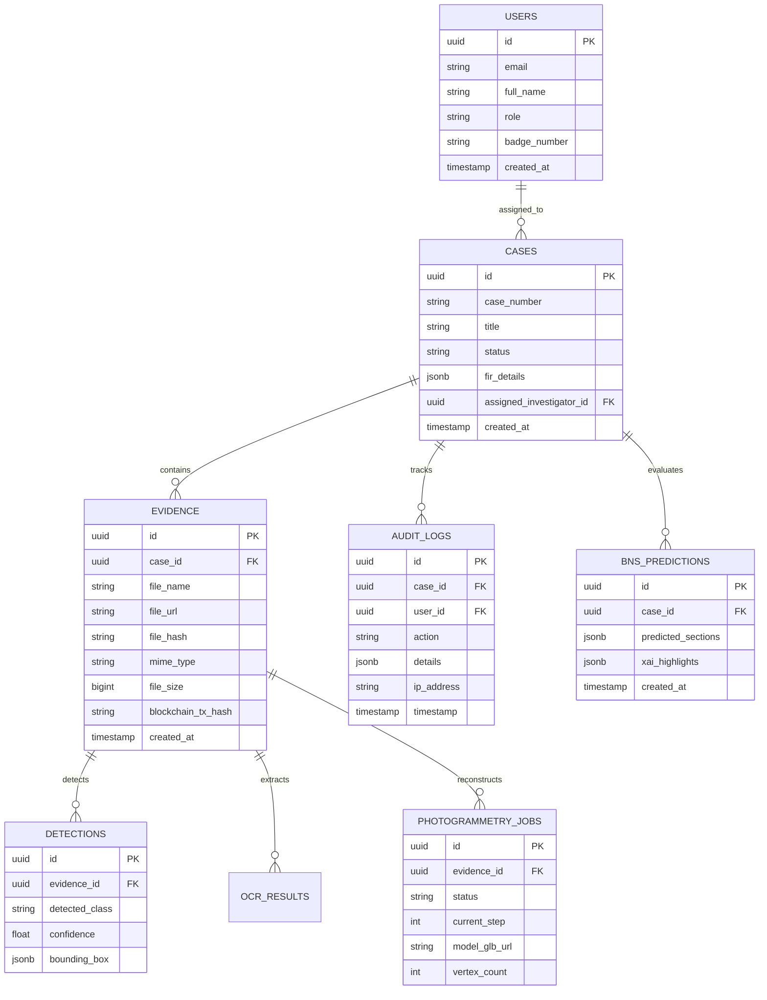

# Secure Audit — Digital Evidence & Investigation Support System

> **Authoritative public-submission guide:** The following section describes exactly what is included in this repository. Private AI services, models, datasets, evidence uploads, backups, local runtime output, and real configuration values are not included.

## Public project overview

Secure Audit is a digital-evidence management application. Its submitted core lets authorised users create cases, upload evidence, compute SHA-256 hashes, register/verify evidence through a local Ethereum ledger, perform multilingual OCR, and view audit logs and notifications.

### Included workflow

1. Sign in and create a case.
2. Upload evidence and link it to that case.
3. Generate a SHA-256 evidence digest.
4. Register or verify the digest against the local blockchain ledger.
5. Run OCR on eligible image/document evidence.
6. Search OCR text and review audit history.

### Included technologies

| Area | Technology |
| --- | --- |
| Frontend | React 18, TypeScript, Vite, React Router, Axios |
| Backend | Python 3.10, FastAPI, Uvicorn, SQLAlchemy |
| Database | PostgreSQL or Supabase PostgreSQL |
| Integrity | SHA-256 |
| Blockchain | Solidity, Web3.py, Hardhat, Ganache |
| OCR | PaddleOCR, Tesseract, PyMuPDF, pdf2image |

## Exact public structure

```text
Secure-Audit/
├── .gitignore                        # Ignores secrets, generated data, and private modules
├── README.md                         # This documentation
├── schema.sql                        # PostgreSQL schema for a fresh installation
├── audit-frontend/                   # React/Vite frontend
│   ├── .env.example                  # Safe frontend configuration template
│   ├── package.json / package-lock.json
│   ├── vite.config.ts / tsconfig.json
│   ├── public/logo.png
│   ├── scripts/                      # GLTF/GLB helper scripts
│   └── src/
│       ├── main.tsx                  # React entry point
│       ├── App.tsx                   # Routes and role protection
│       ├── components/               # Layout, UI, alerts, OCR viewer
│       ├── context/                  # Authentication and theme state
│       ├── pages/                    # Login, dashboard, cases, evidence, users, ledger
│       ├── services/                 # FastAPI and optional Supabase clients
│       ├── styles/globals.css
│       └── types/index.ts
├── backend/                           # FastAPI core application
│   ├── .env.example                  # Safe backend configuration template
│   ├── app.py                        # API routes and application startup
│   ├── db.py                         # Database connection/session setup
│   ├── models.py                     # SQLAlchemy models
│   ├── requirements.txt              # Python dependencies
│   ├── services/
│   │   ├── blockchain_service.py     # EvidenceRegistry/Web3 integration
│   │   ├── evidence_integrity.py     # SHA-256 verification helpers
│   │   ├── ocr_service.py            # PaddleOCR processing
│   │   ├── ocr_text.py               # OCR normalisation
│   │   ├── tesseract_engine.py       # Tesseract fallback
│   │   ├── translation_service.py    # OCR translation wrapper
│   │   └── storage_gateway.py        # Local/S3-compatible storage
│   ├── tests/                        # Automated backend checks
│   ├── scripts/                      # Administration/storage utilities
│   ├── setup_tessdata.py             # Tesseract language-data setup
│   └── migrate_*.py                  # Older-database upgrade helpers
└── blockchain/                        # Local Ethereum evidence ledger
    ├── contracts/EvidenceRegistry.sol # Solidity contract
    ├── scripts/deploy.js             # Local deployment script
    ├── deployments/localhost.json    # Local deployment metadata
    ├── package.json / package-lock.json
    ├── hardhat.config.ts
    └── start-ganache.ps1
```

## Database and migrations

`schema.sql` creates the fresh database. It includes users, cases, evidence, OCR results, custody records, blockchain logs, audit logs, OTP tokens, and notifications.

The `migrate_*` files are for upgrading old databases. They do not run during normal use. For a new database, use `schema.sql`. Review and back up an existing database before applying a migration.

## Installation

### Prerequisites

- Node.js 18+
- Python 3.10
- PostgreSQL 15 or a Supabase PostgreSQL project
- Tesseract and Poppler when OCR fallback/PDF OCR is required

### Configure local values

```powershell
Copy-Item backend\.env.example backend\.env
Copy-Item audit-frontend\.env.example audit-frontend\.env
```

Do not commit those `.env` files. At minimum configure the database settings in `backend/.env` and set `VITE_API_BASE_URL=http://localhost:8000` in the frontend configuration.

### Install dependencies

```powershell
cd backend
py -3.10 -m venv venv
.\venv\Scripts\python.exe -m pip install -r requirements.txt
cd ..

cd audit-frontend
npm install
cd ..

cd blockchain
npm install
cd ..
```

### Initialise and run

Import `schema.sql` into an empty PostgreSQL database, then use three PowerShell terminals:

```powershell
# Terminal 1: blockchain
cd blockchain
npm run chain
```

```powershell
# Terminal 2: backend
cd backend
.\venv\Scripts\python.exe app.py
```

```powershell
# Terminal 3: frontend
cd audit-frontend
npm run dev
```

Open `http://localhost:5173`. The API documentation is at `http://127.0.0.1:8000/docs`.

To deploy the local evidence contract after starting Ganache:

```powershell
cd blockchain
npx hardhat compile
node scripts/deploy.js
```

## API groups

| Group | Core routes |
| --- | --- |
| Authentication | `/auth/send-otp`, `/auth/verify-otp`, `/auth/me` |
| Cases | `/cases`, `/cases/{case_id}`, `/cases/stats` |
| Evidence | `/evidence/upload`, `/evidence`, `/evidence/{id}/verify` |
| OCR | `/ai/ocr`, `/ocr/search` |
| Blockchain | `/blockchain/status`, `/blockchain/register`, `/blockchain/verify` |
| Notifications | `/notifications`, `/notifications/stream` |
| Audit | `/audit` |
| Users | `/users` |

## Security and Git policy

The root `.gitignore` prevents publishing real configuration values, keys, credentials, uploads, backups, logs, caches, virtual environments, `node_modules`, blockchain runtime data, build artifacts, and private modules. Only safe `.env.example` templates are version-controlled.

## Excluded local modules

The following remain local-only and are not part of the public repository: `audio-backend/`, `best/` (object detection), `bns-backend/`, `photogrammetry-backend/`, `backups/`, local uploads, models, datasets, and generated outputs.

<details>
<summary>Legacy full-development reference — not part of the public submission</summary>


[](audit-frontend/)
[](backend/)
[](blockchain/)

Secure Audit is a digital-evidence management application that provides case management, role-based access, evidence upload, SHA-256 integrity verification, local Ethereum/Ganache ledger integration, multilingual OCR, audit logging, and notifications.

> **Public submission scope:** this repository includes the frontend, core backend, OCR workflow, PostgreSQL schema, and blockchain module. Private/experimental AI services, their models and datasets, local evidence, runtime data, and all real configuration values are intentionally excluded.

---

## Table of Contents

1. [Project Title](#1-project-title)
2. [Overview](#2-overview)
3. [Features](#3-features)
4. [System Architecture](#4-system-architecture)
5. [Project Structure](#5-project-structure)
6. [Technology Stack](#6-technology-stack)
7. [System Workflow](#7-system-workflow)
8. [Module Descriptions](#8-module-descriptions)
9. [API Overview](#9-api-overview)
10. [Database Design](#10-database-design)
11. [Blockchain Integration](#11-blockchain-integration)
12. [AI Components](#12-ai-components)
13. [Security Features](#13-security-features)
14. [Installation](#14-installation)
15. [Running the Project](#15-running-the-project)
16. [Environment Variables](#16-environment-variables)
17. [Screenshots](#17-screenshots)
18. [Future Scope](#18-future-scope)
19. [Contributors](#19-contributors)
20. [License](#20-license)

---

## 1. Project Title

**Secure Audit** — *DIGITAL EVEIDENCE AND INVESTIGATION SUPPORT SYSTEM *

---

## 2. Overview

### Purpose
Modern criminal investigations generate vast quantities of digital evidence (CCTV footage, intercepted audio, weapon imagery, scanned FIR documents, and mobile forensics). Traditional evidence handling relies on fragmented storage and manual logs, leaving evidence vulnerable to physical tampering, digital alterations, and procedural chain-of-custody challenges in court.

### Problem Statement
1. **Chain of Custody Vulnerability:** Lack of tamper-evident, decentralized verification makes proving evidence integrity difficult under legal scrutiny.
2. **Analysis Bottlenecks:** Manual examination of hours of surveillance video, multilingual FIRs, and forensic audio logs slows down charge-sheet filing.
3. **Legal Classification Complexity:** Mapping intricate incident narratives to newly enacted criminal codes (**Bharatiya Nyaya Sanhita, 2023**) requires specialized legal cross-referencing.
4. **Spatial Evidence Loss:** 2D crime scene photographs fail to preserve critical spatial geometry, distances, and 3D weapon trajectories.

### Objectives
- **Cryptographic Evidence Anchoring:** Compute SHA-256 digests on ingest and anchor them to an Ethereum smart contract ledger for mathematically verifiable integrity.
- **Automated AI Triage:** Detect weapons and illicit objects (YOLOv8), transcribe and analyze forensic audio (WhisperX & pyannote), and reconstruct 3D spatial scenes (COLMAP & Open3D).
- **Multilingual Legal Extraction:** Extract text from regional FIRs and legal documents with multilingual OCR (PaddleOCR/Tesseract) and classify applicable BNS penal sections with Explainable AI (Legal-BERT + HGAT).
- **Strict Role-Based Governance:** Enforce granular access control (Admin, Investigator, Forensic Examiner) backed by append-only audit trails.

### Real-World Use Case
A police department registers a multi-jurisdiction armed robbery. The investigation team uploads CCTV video, recovered weapon images, scanned regional FIRs, and recorded witness interviews. Secure Audit hashes each artifact onto the blockchain, extracts regional text from the FIR, predicts applicable BNS sections (e.g., robbery, armed assembly), runs weapon detection across footage, transcribes audio, builds a navigable 3D point cloud of the crime scene, and exports a tamper-proof court-admissible forensic report.

---

## 3. Features

### Authentication & Authorization
- **Supabase & JWT Authentication:** Secure login with session tokens and role-based payload validation.
- **Role-Based Access Control (RBAC):** Strict operational permissions for `Admin`, `Investigator`, and `Forensic Examiner`.
- **Session Security:** Automatic token validation and revocation handling.

### Case Management
- **Centralized Case Registry:** Unique, standardized case numbers (`SA-YYYY-XXXX`).
- **FIR Incident Details:** Structured metadata capture (offence category, incident timestamp, geographic location, complainant, victims, and suspects).
- **Investigator Assignment:** Link case responsibility to authorized officers and forensic teams.
- **POLE Entity Graphs:** Interactive Person-Object-Location-Event entity relationship mapping.

### Evidence Management
- **Multi-Format Ingestion:** Support for images (`.jpg`, `.png`, `.webp`), videos (`.mp4`, `.mov`, `.avi`), audio (`.mp3`, `.wav`, `.m4a`), and documents (`.pdf`).
- **Cryptographic Hashing:** Automated SHA-256 fingerprint generated at the exact millisecond of upload.
- **Structured Case Partitioning:** Secure local storage partitioned by case UUIDs (`backend/uploads/cases/{case_id}/`).
- **Duplicate Detection:** Automatic pre-upload hash comparison against historical records to prevent redundant storage.

### Blockchain Verification
- **Smart Contract Registry:** `EvidenceRegistry.sol` (Solidity 0.8.28) deployed on Ethereum/Ganache.
- **Immutable State Logs:** On-chain storage of `evidenceId`, `caseId`, `sha256Hash`, `uploader`, and `timestamp`.
- **One-Click Integrity Verification:** Live re-hashing of stored binary files compared against on-chain smart contract state with instant status badge (`Verified` / `Tampered`).
- **Custody Transfer Auditing:** Smart-contract-enforced custody change logs (`REGISTERED`, `VERIFIED`, `TRANSFERRED`).

### Optical Character Recognition (OCR)
- **High-Accuracy Multilingual Engine:** PaddleOCR (PP-OCRv5) for primary document and print parsing.
- **Regional Script Support:** Tesseract 5 fallback for regional Indic scripts (Kannada, Malayalam, Hindi, Tamil, Telugu).
- **Preprocessing & Normalization:** Automatic document deskewing, binarization, and orientation correction.
- **PDF Extraction:** Automatic multi-page PDF rasterization and page-by-page text mapping.

### Translation
- **Multilingual Legal Translation:** Translate regional FIR and witness text into English/standard format using integrated translation pipelines.
- **Preserved Entity Context:** Retains legal terminology and named entities during translation passes.

### BNS Legal Prediction
- **Bharatiya Nyaya Sanhita (BNS) Classification:** Multi-label neural classification predicting applicable criminal sections from FIR narratives.
- **Hybrid AI Architecture:** Legal-BERT sentence embeddings + Hierarchical Graph Attention Network (HGAT).
- **Explainable AI (XAI):** Sentence-level highlighting of narrative triggers justifying each predicted section.
- **Semantic Vector Search:** FAISS vector indexing over statutory definitions with penalty duration and cognizability metadata.

### 3D Photogrammetry & Scene Reconstruction
- **Automated Video-to-3D Pipeline:** Extract keyframes from crime scene video walkthroughs.
- **Structure-from-Motion (SfM):** COLMAP sparse and dense point cloud estimation.
- **Point Cloud & Mesh Post-Processing:** Open3D noise filtering, surface Poisson reconstruction, and GLB asset export.
- **Interactive Three.js Viewer:** Orbit, pan, zoom, and take spatial measurements directly inside the browser dashboard.

### Audio Forensics
- **Speech-to-Text Transcription:** WhisperX automatic speech recognition for recorded calls and interrogation tapes.
- **Speaker Diarization:** pyannote.audio speaker separation and voice turn timestamps.
- **Deepfake Audio Detection:** Acoustic frequency spectrum analysis and synthetic voice artifact scoring.
- **Forensic Entity Extraction:** Automatic extraction of named entities (names, times, locations) from transcripts via spaCy.

### Crime & Weapon Detection
- **Computer Vision Inference:** YOLOv8 neural network trained on forensic object datasets.
- **Threat Detection:** Real-time localization and bounding-box annotation for firearms, knives, and contraband.
- **Evidence Cross-Referencing:** Detected weapon classes automatically linked to case storyboard and BNS charge recommendations.

### Audit Logs & Governance
- **Append-Only Action Logs:** Every login, upload, verification, AI execution, and status change recorded with user ID, IP address, and timestamp.
- **Tamper-Evident History:** Unalterable chronological audit logs exportable for departmental compliance.

### User Management
- **Officer & Specialist Directory:** Manage registered investigators, department badges, and assigned roles.
- **Activity Monitoring:** Track officer active cases and forensic review history.

### Case Notes & Collaboration
- **Time-Stamped Case Annotations:** Add categorized forensic remarks, investigator notes, and forensic hypotheses directly to case files.

---

## 4. System Architecture

Secure Audit is built as a modular, distributed microservices architecture communicating via REST APIs and Web3 JSON-RPC protocols:

```
                                  +--------------------------------------------------+
                                  |            React 18 Frontend Dashboard           |
                                  |         (Vite + TailwindCSS + Lucide Icons)      |
                                  +------------------------+-------------------------+
                                                           |
                                                REST API / JWT Session
                                                           |
                                                           v
                                  +--------------------------------------------------+
                                  |            Core Backend Gateway (8000)           |
                                  |           FastAPI + SQLAlchemy + Pydantic        |
                                  +---+------------+------------+---------------+----+
                                      |            |            |               |
             +------------------------+            |            |               +-----------------------+
             |                                     |            |                                       |
             v                                     v            v                                       v
+------------------------+             +--------------+  +--------------+                   +------------------------+
|   PostgreSQL Database  |             |  Blockchain  |  | Supabase Auth|                   | Local Evidence Storage |
|  (Cases, Evidence,     |             |  (Ethereum / |  | (User Session|                   | (backend/uploads/      |
|   Detections, Audits)  |             |   Ganache)   |  |   & JWTs)    |                   |  cases/{case_id}/)     |
+------------------------+             +--------------+  +--------------+                   +------------------------+
             ^
             |
             +--------------------------------------------------------------------------------------------------+
             |                                              |                                                   |
             v                                              v                                                   v
+------------------------+                    +---------------------------+               +-----------------------------------+
|  Crime Detection (8003)|                    |    BNS Backend (8001)     |               |   Photogrammetry Backend (8004)   |
|   YOLOv8 Computer      |                    | Legal-BERT + HGAT Network |               |   COLMAP SfM + Open3D Meshing     |
|   Vision Service       |                    | + FAISS Statutory Search  |               |   Jobs: input_video -> GLB model  |
+------------------------+                    +---------------------------+               +-----------------------------------+
             |
             v
+------------------------+
|  Audio Backend (8002)  |
|  WhisperX + pyannote   |
|  Speech & Deepfake AI  |
+------------------------+
```

---

## 5. Project Structure

```
Secure Audit/
├── audit-frontend/             # React 18 frontend (Vite, TailwindCSS, Three.js)
│   ├── src/
│   │   ├── components/         # Reusable UI widgets, navigation, 3D viewers
│   │   ├── pages/              # Dashboard, Cases, Evidence, BNS, Photogrammetry
│   │   ├── context/            # Authentication & application state providers
│   │   └── services/           # Axios HTTP API client integration
│   ├── package.json            # Node.js dependencies
│   └── vite.config.js          # Vite build configuration
│
├── backend/                    # Core API Gateway (FastAPI, Port 8000)
│   ├── services/               # Blockchain, OCR, Translation, AI orchestration
│   ├── app.py                  # Main FastAPI application router and endpoints
│   ├── models.py               # SQLAlchemy database models
│   ├── db.py                   # PostgreSQL connection lifecycle
│   └── requirements.txt        # Python dependencies
│
├── blockchain/                 # Ethereum Smart Contracts & Migrations
│   ├── contracts/              # EvidenceRegistry.sol
│   ├── scripts/                # Hardhat deployment scripts
│   └── hardhat.config.ts       # Hardhat / Ganache network settings
│
├── schema.sql                  # PostgreSQL schema
└── README.md                   # Setup and submission documentation
```

---

## 6. Technology Stack

| Domain | Technologies |
| :--- | :--- |
| **Frontend** | React 18, Vite, TailwindCSS, Lucide Icons, Three.js, Axios, React Router 6 |
| **Core Backend** | Python 3.10, FastAPI, Uvicorn, SQLAlchemy, Pydantic, Web3.py |
| **Database** | PostgreSQL 15, Supabase Database |
| **Authentication** | Supabase Auth, JWT Tokens, PBKDF2 Hashing |
| **Blockchain** | Ethereum, Solidity, Hardhat, Ganache CLI / Local Node |
| **OCR & Text** | PaddleOCR (PP-OCRv5), Tesseract 5, PyMuPDF, pdf2image |

---

## 7. System Workflow

```
[ Investigator Login ]
          │
          ▼
[ Create Forensic Case ] ──► (Generates SA-YYYY-XXXX & DB Record)
          │
          ▼
[ Upload Evidence File ]
          │
          ├──────────────────────────────────────────────────────┐
          ▼                                                      ▼
[ Compute SHA-256 Digest ]                               [ Save Binary File ]
          │                                            (backend/uploads/cases/{id}/)
          ▼
[ Register on Blockchain ]
(EvidenceRegistry.sol on Ganache)
          │
          ├──────────────────────────┬──────────────────────────┬──────────────────────────┐
          ▼                          ▼                          ▼                          ▼
  [ Document / Image ]        [ Crime Image ]             [ Scene Video ]           [ Audio Tape ]
          │                          │                          │                          │
          ▼                          ▼                          ▼                          ▼
  [ Multilingual OCR ]     [ YOLOv8 Detection ]     [ Frame Selection & SfM ]    [ WhisperX Diarization ]
          │                          │                          │                          │
          ▼                          ▼                          ▼                          ▼
  [ Regional Translate ]   [ Weapon Bounding Boxes]   [ COLMAP + Open3D Meshing ] [ Deepfake Detection ]
          │                          │                          │                          │
          ▼                          │                          ▼                          │
  [ Legal-BERT + HGAT ]              │                 [ Three.js 3D View ]                │
  [ BNS Code Prediction]             │                          │                          │
          │                          │                          │                          │
          └──────────────────────────┴──────────────────────────┴──────────────────────────┘
                                     │
                                     ▼
                        [ Append-Only Audit Log ]
                                     │
                                     ▼
                     [ Live Hash Verification in UI ]
                     (Local SHA-256 vs. Blockchain Ledger)
```

---

## 8. Module Descriptions

### Core API Gateway (`backend/`)
The central FastAPI application. It manages authentication, users, cases, evidence upload, SHA-256 computation, OCR results, audit logs, notifications, and blockchain verification.

### Blockchain Evidence Registry (`blockchain/`)
Contains the Solidity smart contract `EvidenceRegistry.sol`. Serves as the immutable root of trust, recording cryptographic hashes, case mappings, and chronological custody transfers across Ganache or any EVM-compatible network.

---

## 9. API Overview

The public submission exposes these core API groups:

| Group | Base Route | Description |
| :--- | :--- | :--- |
| **Authentication** | `POST /auth/login`, `POST /auth/register` | User authentication, token issuance, password management |
| **Cases** | `GET/POST /cases/`, `GET /cases/{id}` | Case creation, FIR details, investigator assignment, POLE data |
| **Evidence** | `POST /evidence/upload`, `GET /evidence/{id}` | File ingestion, SHA-256 calculation, metadata retrieval |
| **Blockchain** | `POST /blockchain/verify`, `GET /blockchain/custody/{id}` | On-chain hash verification, block info, custody logs |
| **OCR & Text** | `POST /ai/ocr`, `GET /ocr/search` | PaddleOCR/Tesseract parsing, search, and multilingual translation |
| **Audit Logs** | `GET /audit/logs`, `GET /audit/case/{id}` | Immutable system activity logs and compliance history |
| **Users** | `GET/POST /users/`, `PATCH /users/{id}/role` | Officer administration, RBAC roles, profile management |

---

## 10. Database Design

Secure Audit uses a relational PostgreSQL database schema managed through SQLAlchemy ORM:



---

## 11. Blockchain Integration

### Cryptographic Evidence Integrity
1. **Hashing on Ingestion:** When an evidence file reaches the backend, its binary stream is processed through SHA-256:
   $$	ext{Evidence Hash} = 	ext{SHA-256}(	ext{Raw Binary Data})$$
2. **Smart Contract Storage:** The hash is anchored permanently into the Ethereum smart contract via `EvidenceRegistry.sol`:
   ```solidity
   function registerEvidence(
       string memory _evidenceId,
       string memory _caseId,
       string memory _fileName,
       string memory _sha256Hash
   ) public returns (bool);
   ```
3. **Chain of Custody Tracking:** Any transfer of evidence between investigators or forensic labs appends an on-chain event (`CustodyTransferred`).
4. **Verification Workflow:** During court presentation or audit review, the system reads the stored file, re-computes its SHA-256 hash in real-time, queries the smart contract, and evaluates:
   $$	ext{Status} = egin{cases} \mathbf{VERIFIED} & 	ext{if } 	ext{SHA-256}(	ext{File}) == 	ext{Hash}_{	ext{Blockchain}} \ \mathbf{TAMPERED} & 	ext{if } 	ext{SHA-256}(	ext{File}) 
eq 	ext{Hash}_{	ext{Blockchain}} \end{cases}$$

---

## 12. AI Components

| AI Engine | Model / Architecture | Primary Function | Input $
ightarrow$ Output |
| :--- | :--- | :--- | :--- |
| **Crime Detection** | YOLOv8 (`crime_best.pt`) | Detect weapons, firearms, knives | Image/Video $
ightarrow$ Annotated Bounding Boxes + Confidence |
| **BNS Classifier** | Legal-BERT + HGAT Network | Multi-label penal section prediction | FIR Narrative $
ightarrow$ Top BNS Sections + XAI Triggers |
| **Semantic Search** | FAISS + SentenceTransformers | Fast statutory law retrieval | Legal Query $
ightarrow$ Relevant Statutory Articles & Penalties |
| **Multilingual OCR**| PaddleOCR (PP-OCRv5) + Tesseract 5 | Text extraction from regional documents | Scanned FIR Image/PDF $
ightarrow$ Extracted Unicode Text |
| **3D Photogrammetry**| COLMAP (SfM) + Open3D | 3D crime scene reconstruction | Walkthrough Video $
ightarrow$ Dense Point Cloud + 3D Mesh (GLB) |
| **Audio Forensics** | WhisperX + pyannote.audio | Speech-to-text & deepfake scoring | Audio Recording $
ightarrow$ Diarized Transcript + Fake Score |

---

## 13. Security Features

- **Decentralized Integrity:** Immutable SHA-256 anchoring guarantees cryptographic proof against server-side data tampering.
- **Role-Based Access Control (RBAC):** Strict separation of privileges between administrators, forensic analysts, and field investigators.
- **JWT & Supabase Session Security:** Cryptographically signed tokens with automatic expiry and authenticated route guards.
- **Isolated Evidence Storage:** Evidence binaries stored in UUID-isolated case directories with restricted static access.
- **Comprehensive Audit Trail:** Append-only operational logging capturing IP addresses, user IDs, timestamps, and state transitions.

---

## 14. Installation

### Prerequisites
- **Node.js:** v18.0 or higher
- **Python:** v3.10
- **PostgreSQL:** v15 or higher (or Supabase PostgreSQL instance)
- **Local blockchain:** Node.js packages installed with `npm install` in `blockchain/`; Ganache is started with `npm run chain`.
- **COLMAP:** Installed and available on system `PATH` (for 3D photogrammetry)

### 1. Clone the Repository
```bash
git clone https://github.com/Josna-01/Secure-Audit.git
cd "Secure Audit"
```

### 2. Prerequisites

- Windows with PowerShell, Node.js 18+ and Python 3.10 available as `py -3.10`.
- PostgreSQL 15+ running locally (or a configured Supabase PostgreSQL database).
- Tesseract 5 plus the required Indic language data if multilingual OCR fallback is required.

### 3. Configure services

Copy the available `.env.example` files to `.env`, then populate the required values. Do not commit the resulting `.env` files.

```powershell
Copy-Item backend\.env.example backend\.env
Copy-Item audit-frontend\.env.example audit-frontend\.env
```

At minimum, configure PostgreSQL credentials in `backend/.env`. Configure Supabase and SMTP credentials for their respective integrations. The frontend needs `VITE_API_BASE_URL=http://localhost:8000`; it also needs Supabase URL and anonymous key when Supabase-backed features are enabled.

### 4. Install dependencies

Install Node packages for the frontend and local blockchain:

```powershell
cd blockchain; npm install; cd ..
cd audit-frontend; npm install; cd ..
```

Create a Python 3.10 environment for the core backend and install its dependencies.

```powershell
cd backend; py -3.10 -m venv venv; .\venv\Scripts\python.exe -m pip install -r requirements.txt; cd ..
```

---

## 15. Running the Project

Run each public component in a separate terminal:

| Service | Command | URL / port |
| :--- | :--- | :--- |
| Blockchain node | `cd blockchain; npm run chain` | `http://127.0.0.1:8545` |
| Core API | `cd backend; $env:AUTO_SPAWN_MICROSERVICES="False"; .\venv\Scripts\python.exe app.py` | `http://127.0.0.1:8000` (`/docs`) |
| Frontend | `cd audit-frontend; npm run dev` | `http://localhost:5173` |

### Blockchain deployment

Ganache persists local chain data in `blockchain/ganache-data`. After a deliberately new Ganache database, deploy the contract once, then restart the backend:

```powershell
cd blockchain
npx hardhat compile
node scripts/deploy.js
```

---

## 16. Environment Variables

Use the committed `.env.example` templates as the canonical, current reference. Key settings are:

| Service | Required local configuration |
| :--- | :--- |
| `backend` | PostgreSQL via `DATABASE_URL` or `DB_HOST`, `DB_PORT`, `DB_NAME`, `DB_USER`, and `DB_PASSWORD`; optional Supabase, SMTP, R2/S3, OCR, and blockchain variables. |
| `audit-frontend` | `VITE_API_BASE_URL`, plus `VITE_SUPABASE_URL` and `VITE_SUPABASE_ANON_KEY` where Supabase is used. |

The backend uses local evidence storage by default (`STORAGE_BACKEND=local`). Configure Supabase and/or S3-compatible R2 only when those services are intentionally part of the deployment.

---

## 17. Screenshots

| Case Management & Evidence Hub | 3D Crime Scene Reconstruction |
| :---: | :---: |
| *Dashboard showing verified case evidence and blockchain status* | *Interactive 3D point cloud reconstructed from scene video* |
| *(Screenshot Placeholder)* | *(Screenshot Placeholder)* |

| BNS Legal Prediction & XAI | YOLOv8 Weapon Detection |
| :---: | :---: |
| *Ranked BNS sections with highlighted narrative triggers* | *Real-time weapon and firearm bounding boxes* |
| *(Screenshot Placeholder)* | *(Screenshot Placeholder)* |

---

## 18. Future Scope

- **Edge Deployment for Patrol Units:** Lightweight mobile edge inference for on-scene evidence hashing and instant weapon scanning.
- **Zero-Knowledge Proofs (ZKP):** Implement zk-SNARKs for selective evidence disclosure without revealing sensitive case details.
- **Multimodal Video Diarization:** Synchronized facial recognition and voice diarization across multi-camera interrogation rooms.
- **National Crime Records Integration:** Automated interoperability with national criminal databases and CCTNS frameworks.

---

## 19. Contributors

Secure Audit was developed by the project team as an academic digital-forensics project.

</details>
