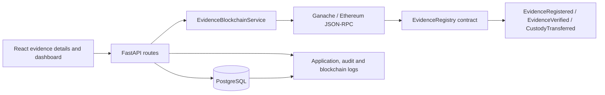
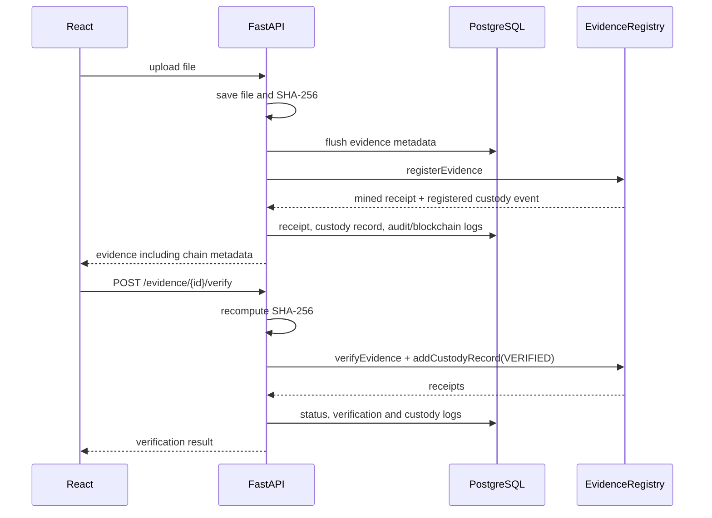

# Blockchain integration

## Architecture

## Upload and verification sequence

## API

| Method | Endpoint | Purpose |
| --- | --- | --- |
| POST | `/evidence/upload` | Stores file and metadata, registers it on-chain, returns receipt metadata. |
| POST | `/evidence/{id}/verify` | Re-hashes the file, verifies on-chain, and appends custody. |
| GET | `/evidence/{id}/blockchain` | Chain status, stored receipt metadata and chronological custody history. |
| POST | `/evidence/{id}/custody/transfer` | Body: `{"officer_id":"..."}`. Appends a TRANSFERRED custody entry. |
| GET | `/blockchain/dashboard` | Admin chain health, evidence counts, transactions and blocks. |
| POST | `/admin/blockchain/redeploy` | Admin-only compile/deploy, then reloads ABI and deployment address. |

## Database changes

`evidence` gains transaction hash, block number, contract address, gas used, registration timestamp, and latest verification timestamp. `evidence_custody_records` is the queryable mirror of custody events; `blockchain_logs` is the immutable local event/transaction log. Apply with `python migrate_blockchain.py` from `backend`.

## Deployment

1. Start PostgreSQL and apply existing schema, then run `python migrate_blockchain.py` in `backend`.
2. In `blockchain`, start Ganache at the configured RPC endpoint, then run `npx hardhat compile` and `node scripts/deploy.js`. The script writes `blockchain/deployments/localhost.json`; the backend automatically reads it.
3. Install backend requirements and start FastAPI from `backend`: `uvicorn app:app --reload`.
4. Start the React client from `audit-frontend`: `npm run dev`.

Use these environment variables: `ETHEREUM_RPC_URL`, `EVIDENCE_REGISTRY_ADDRESS` (optional when deployment JSON exists), `EVIDENCE_REGISTRY_ARTIFACT` (optional), `EVIDENCE_REGISTRY_DEPLOYMENT` (optional), `ETHEREUM_SENDER_ADDRESS`, `ETHEREUM_PRIVATE_KEY` (server-only; never prefix with `VITE_`), `BLOCKCHAIN_TX_TIMEOUT_SECONDS`, and `BLOCKCHAIN_RETRIES`.

Ganache may use its unlocked account through `ETHEREUM_SENDER_ADDRESS`; production deployments should provide a protected `ETHEREUM_PRIVATE_KEY` via the server secret manager.
