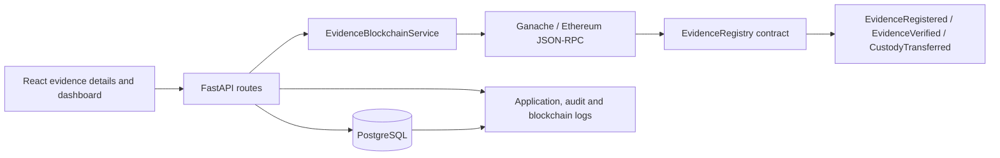
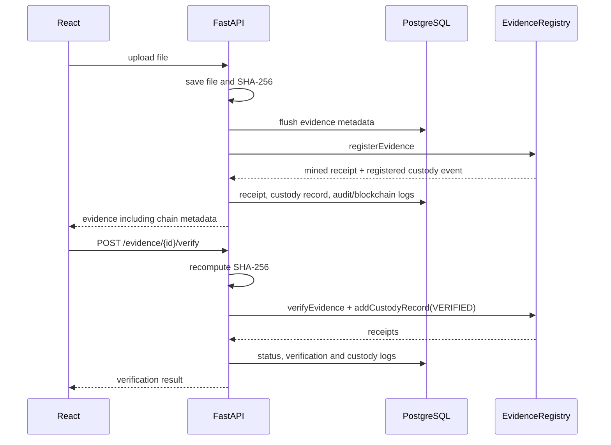

# Blockchain integration

## Architecture

## Upload and verification sequence

## API

All endpoints except `/blockchain/status` and `/health` require a JWT. Evidence-scoped endpoints apply the
same case-level access rules as the rest of the application (investigators see their own cases, admins all).

| Method | Endpoint | Access | Purpose |
| --- | --- | --- | --- |
| POST | `/evidence/upload` | uploader | Validates input, stores the file, registers its SHA-256 on-chain, persists the full receipt. |
| POST | `/evidence/{id}/verify` | case access | Re-hashes the stored file and verifies it on-chain (see statuses below). |
| GET | `/evidence/{id}/blockchain` | case access | Receipt metadata, on-chain custody and the merged custody timeline. |
| GET | `/evidence/{id}/download` | case access | Audited download; `X-Evidence-SHA256` and `X-Evidence-Integrity` headers. |
| PATCH | `/evidence/{id}` | uploader / admin | Edit description or type only; recorded as `METADATA_MODIFIED` custody. |
| POST | `/evidence/{id}/custody/transfer` | case access | Body `{"officer_id": "<user UUID>"}`; target must be an active user. |
| GET | `/blockchain/status` | public | Liveness summary without internal error details. |
| GET | `/blockchain/network` | any user | Node, contract code, signing wallet, registrar authorisation, latency. |
| GET | `/blockchain/ledger` | any user (scoped) | Paginated ledger rows (`search`, `status`, `limit`, `offset`). |
| GET | `/blockchain/evidence/{id}` | case access | Ledger detail: stored + on-chain record, integrity checks, custody timeline. |
| GET | `/blockchain/transaction/{txHash}` | case access / admin | Decoded transaction, receipt and events (Ganache has no explorer). |
| GET | `/blockchain/history/{id}` | case access | On-chain custody, merged timeline and local event log. |
| GET | `/blockchain/dashboard` | any user (scoped) | Counts, success rate, latest transactions and verification events. |
| POST | `/blockchain/integrity-scan` | admin | Database-vs-chain check of every item; backfills metadata, audits inconsistencies. |
| POST | `/blockchain/register` | admin | Repair path for unregistered evidence; hash must match the stored file and upload hash. |
| POST | `/blockchain/verify` | admin | Checks a caller-supplied hash; never changes the evidence status. |
| POST | `/admin/blockchain/redeploy` | admin | Compile, deploy and reload the contract. |
| GET | `/health` | public | Database (required) and blockchain (may be degraded) readiness. |

## Database changes

`evidence` stores the full registration receipt: transaction hash, block number, block hash, wallet (sender)
address, chain id, contract address, gas used, transaction status and registration time, plus
`last_verification_result` / `last_verification_reason` for the most recent attempt.
`evidence_custody_records` holds every custody event; `source` is `blockchain` for entries mirrored from the
contract and `database` for off-chain events (created, viewed, downloaded, metadata modified), with optional
`details`. `blockchain_logs` is the local event/transaction log. All changes are additive: run
`python migrate_blockchain.py` in `backend`, or let the API apply them at startup.

## Deployment

1. Start PostgreSQL and apply existing schema, then run `python migrate_blockchain.py` in `backend`.
2. In `blockchain`, start Ganache at the configured RPC endpoint, then run `npx hardhat compile` and `node scripts/deploy.js`. The script writes `blockchain/deployments/localhost.json`; the backend automatically reads it.
3. Install backend requirements and start FastAPI from `backend`: `uvicorn app:app --reload`.
4. Start the React client from `audit-frontend`: `npm run dev`.

Use these environment variables: `ETHEREUM_RPC_URL`, `EVIDENCE_REGISTRY_ADDRESS` (optional when deployment JSON exists), `EVIDENCE_REGISTRY_ARTIFACT` (optional), `EVIDENCE_REGISTRY_DEPLOYMENT` (optional), `ETHEREUM_SENDER_ADDRESS`, `ETHEREUM_PRIVATE_KEY` (server-only; never prefix with `VITE_`), `BLOCKCHAIN_TX_TIMEOUT_SECONDS`, `BLOCKCHAIN_RETRIES`, and `BLOCKCHAIN_AUTO_REDEPLOY` (default `false`).

Ganache may use its unlocked account through `ETHEREUM_SENDER_ADDRESS`; production deployments should provide a protected `ETHEREUM_PRIVATE_KEY` via the server secret manager.

## Persistence and legacy evidence

Run Ganache with an on-disk database so registrations survive restarts: `blockchain/start-ganache.ps1` (or `npm run chain` in `blockchain`). An in-memory Ganache loses every registration when it stops. The backend no longer redeploys a missing contract automatically (`BLOCKCHAIN_AUTO_REDEPLOY=false`); it reports the problem instead, because a silently redeployed empty registry would make every existing evidence item fail verification.

Evidence without a valid on-chain registration (uploaded before the integration, or registered on a contract lost to a chain reset) is handled by `python backfill_blockchain_registration.py` in `backend` (dry run by default, `--apply` to write). Items whose file still matches the upload hash are registered; the rest are marked `Unregistered`, never `Verified`, with an audit log entry explaining why.

## Verification statuses

`POST /evidence/{id}/verify` re-hashes the stored file and uses the contract's `EvidenceVerified.isMatch` as the verdict:

| Status | HTTP | Meaning |
|---|---|---|
| `Verified` | 200 | File hash matches the on-chain hash. |
| `Tampered` | 200 | File hash differs from the on-chain hash. |
| `Missing` | 404 | The stored file no longer exists; audit action `Evidence File Missing`. |
| `Unregistered` | 409 | No on-chain registration exists; audit action `Evidence Not Registered On-Chain`. |

The response carries `databaseHash`, `blockchainHash`, `databaseMatchesBlockchain` and `warnings`; a database/blockchain difference is also written to the audit log as `Database Hash Mismatch`. `POST /blockchain/verify` (caller-supplied hash) still records the on-chain check but no longer changes the evidence status.

Every outcome also carries `status`, `reason` (machine-readable) and `reasonText`, and the plain-text `detail`
is unchanged for the existing UI. Additional outcome:

| Status | HTTP | Meaning |
|---|---|---|
| `Verification Failed` | 503 | Blockchain or storage unavailable (`BLOCKCHAIN_UNAVAILABLE`, `STORAGE_UNAVAILABLE`, `TRANSACTION_FAILED`). The evidence status is **not** changed; only `last_verification_result` records the attempt. |

Reasons: `HASH_MATCH`, `HASH_MISMATCH`, `EVIDENCE_MISSING`, `NOT_REGISTERED`, `TRANSACTION_MISSING`,
`DATABASE_MISMATCH`, `BLOCKCHAIN_UNAVAILABLE`, `STORAGE_UNAVAILABLE`, `TRANSACTION_FAILED`. Successful responses
also include `integrityChecks` (database hash vs chain, file vs chain, file name/case vs registration,
transaction present on chain, block and contract match, metadata complete, duplicate SHA-256) and an overall
`integrity` of `Consistent`, `Warning` or `Inconsistent`.

## Security model

* **Only the backend writes.** The contract has an owner and a registrar list; `registerEvidence`,
  `verifyEvidence` and `addCustodyRecord` revert for any other account. The deployer is owner and registrar;
  authorise a different signing account with `REGISTRAR_ADDRESSES=0x... node scripts/deploy.js` or
  `setRegistrar`.
* **Status comes only from a server-side re-hash.** The event listener mirrors contract events for
  traceability but never changes evidence status, and `/blockchain/verify` (caller-supplied hash) is
  admin-only and status-neutral.
* **No duplicate transactions.** A transaction that reached the node is never resent; a slow receipt is
  waited for, and a contract revert is reported immediately instead of retried. Nonce allocation is serialised.
* **Input and storage safety.** Upload IDs must be UUIDs, file names are sanitised, uploads are size-limited,
  local paths are confined to `backend/uploads`, and remote evidence is fetched only from the configured
  Supabase host.
* **Audit trail.** Blockchain actions record user, role, evidence, case, IP address, result and reason:
  `Evidence Registered`, `Hash Verified`, `Tamper Detected`, `Evidence Missing`, `Evidence Not Registered On-Chain`,
  `Verification Failed`, `Blockchain Registration Failed`, `Database Hash Mismatch`, `Integrity Inconsistency
  Detected`, `Duplicate Evidence Hash Detected`, `Evidence Viewed`, `Evidence Downloaded`,
  `Evidence Metadata Modified`, `Evidence Custody Transferred`, `Blockchain Metadata Backfilled` and
  `Unauthorised Blockchain Action`.

## Upgrading the contract

The new contract keeps every function signature, so the backend works with both the previous deployment and
the new one; access control and the `EvidenceTampered` event take effect only after redeployment.
Redeploying creates an empty registry, so follow the same steps as a chain reset:

1. `npx hardhat compile` and `node scripts/deploy.js` in `blockchain` (or `POST /admin/blockchain/redeploy`), then restart the backend.
2. `python backfill_blockchain_registration.py --apply` in `backend` to re-register evidence whose files still match.
3. Optionally run `POST /blockchain/integrity-scan` (Run Integrity Scan on the ledger page).

## Tests

From `backend`: `python -m unittest tests.test_evidence_integrity tests.test_evidence_registry_contract`
(the contract tests start a throwaway Ganache on a free port). The end-to-end API test additionally needs a
disposable database: set `TEST_DATABASE_URL` to a database whose name contains `test`, then run
`python -m unittest tests.test_blockchain_api_e2e`.
