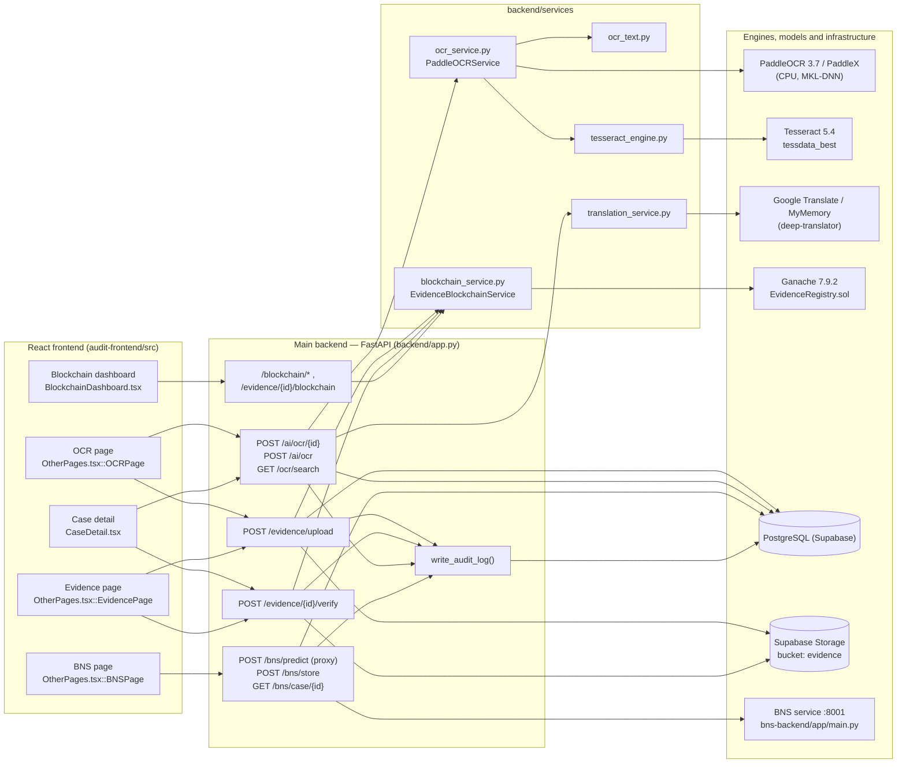
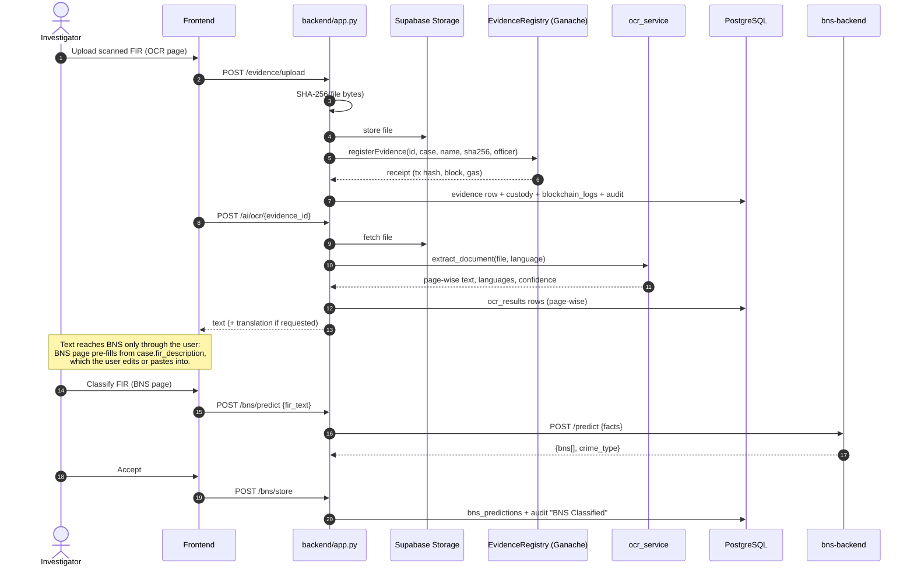

# Chapter 1 — Module Overview

## 1.1 Purpose

The Secure Audit System is a digital-evidence management platform for police investigations. This report covers three of its subsystems:

| Module | What it does | Primary sources |
|---|---|---|
| **OCR** | Extracts text, page by page, from photographed or scanned evidence (images, multi-page TIFF, PDF) in English and five Indian languages, reconstructs layout, and optionally translates the result. | `backend/services/ocr_service.py`, `backend/services/ocr_text.py`, `backend/services/tesseract_engine.py`, `backend/services/translation_service.py`, OCR routes in `backend/app.py` |
| **BNS classification** | Maps a First Information Report (FIR) narrative to applicable sections of the Bharatiya Nyaya Sanhita, 2023 and a crime category. | `bns-backend/app/*.py`; proxy routes in `backend/app.py` |
| **Blockchain evidence integrity** | Anchors the SHA-256 digest of every uploaded evidence file in an Ethereum smart contract and re-verifies files against it, recording a chain of custody. | `blockchain/contracts/EvidenceRegistry.sol`, `backend/services/blockchain_service.py`, evidence/blockchain routes in `backend/app.py` |

## 1.2 Research objective

To design and implement an evidence pipeline in which (i) documentary evidence written in multiple Indian scripts becomes machine-readable text with measurable accuracy, (ii) the narrative facts of a case are mapped to statutory sections of the new Indian criminal code, and (iii) the integrity of every evidence file is independently verifiable against an append-only ledger rather than against the application's own database.

## 1.3 Problems addressed

1. **Multilingual, degraded documents.** FIRs and seized documents in India mix English with Hindi, Kannada, Telugu, Tamil and Malayalam, often on the same line, and arrive as low-resolution photographs, skewed scans or photocopies. General OCR engines are strong on some scripts and weak on others (Chapter 5, Section 5.3.2 measures a 23.4 % character error rate for PaddleOCR on Kannada versus 4.0 % for Tesseract, and the reverse ordering for Tamil).
2. **Statutory mapping after the IPC→BNS transition.** From 1 July 2024 the Bharatiya Nyaya Sanhita replaced the Indian Penal Code; investigators must cite new section numbers. The BNS module provides decision support for this mapping.
3. **Evidence tampering and database trust.** If an evidence hash is stored only in the application database, an attacker with database access can alter both the file and its hash. Anchoring the hash in a blockchain transaction makes silent alteration detectable.

## 1.4 Contributions (as implemented)

1. **A script-aware hybrid OCR pipeline** (`ocr_service.py`). PaddleOCR performs orientation correction, text detection and primary recognition for every page; each low-confidence line is re-read concurrently by the recognizers of the other candidate languages and assigned to the language whose reading scores highest (`_rerecognize`). Lines in scripts where Tesseract measured more accurate (Kannada) or where PaddleOCR has no model (Malayalam) are then re-read by Tesseract, combined with its English model (`_refine_with_tesseract`, `tesseract_engine.read_lines`). Engine-specific failure modes are repaired by explicit rules: dropped leading digits (`restore_dropped_digits`), dropped embedded scripts (`_adds_missing_script`), missing inter-word spaces (`_restore_word_spacing`), upside-down lines (`_fix_upside_down_lines`) and Indic zero/anusvara confusion (`ocr_text.fix_indic_confusions`).
2. **Conditional, quality-preserving preprocessing** (`preprocess_page`): each enhancement (downscaling, noise-estimate-gated non-local-means denoising, bounded upscaling, contrast-gated CLAHE, projection-profile deskew) runs only when a measured image statistic indicates it is needed.
3. **Geometric layout reconstruction** (`ocr_text.reconstruct_layout`): de-skewed row grouping, paragraph detection from vertical gaps, table detection from column-anchor recurrence, and list indentation, all from detector polygons.
4. **A RAG + heterogeneous-graph-attention classifier for BNS sections** (`bns-backend/app/hgat_model.py`, `model_wrapper.py`) with a legal rule layer (`postprocess.py`) that encodes offence-cluster thresholds and factual preconditions (victim age and gender, weapon use, property-versus-kidnapping disambiguation).
5. **On-chain evidence registration and verification** (`EvidenceRegistry.sol`, `blockchain_service.py`) in which the verification verdict is the contract's own `EvidenceVerified.isMatch` event, and the database copy of the hash is cross-checked against the chain.

## 1.5 Architecture overview

The main backend is a single FastAPI application (`backend/app.py`). OCR and blockchain logic run in-process as service singletons (`ocr_service`, `blockchain_service`, `translation_service`). BNS inference runs in a separate process (`bns-backend`), reached over HTTP at the hard-coded address `http://localhost:8001/predict` (`backend/app.py::bns_predict`).

## 1.6 Interaction between OCR, BNS and blockchain

The three modules share the **Case** and **Evidence** entities and the **audit log**. Their coupling, established from the code, is:

Consequences that must be reported accurately:

| Interaction | Status | Evidence |
|---|---|---|
| OCR input files are blockchain-registered evidence | **Implemented.** The OCR page uploads through `/evidence/upload` (which registers on-chain) before calling OCR (`OtherPages.tsx::OCRPage.runExtract`). | `backend/app.py::upload_evidence` |
| OCR output feeds BNS automatically | **Not implemented.** BNS reads `case.fir_description` (`OtherPages.tsx::BNSPage.selectCase`); OCR text is transferred only by the user (copy/paste or editing). | `OtherPages.tsx` |
| OCR text or translations anchored on-chain | **Not implemented.** Only the evidence *file* digest is registered. OCR rows keep their own `raw_text` for audit but are not hashed on-chain. | `EvidenceRegistry.sol`, `ocr_service.py::extract_page` |
| BNS predictions anchored on-chain | **Not implemented.** Stored in `bns_predictions` only. | `backend/app.py::bns_store` |
| Common audit trail | **Implemented.** `write_audit_log` records "Evidence Upload", "Hash Verified", "Tamper Detected", "OCR Extraction", "BNS Classified", and others. | `backend/app.py::write_audit_log` |

## 1.7 Design principles visible in the code

- **Lazy, cached heavy models.** PaddleOCR pipelines and recognizers are loaded on first use and cached per language behind a lock (`PaddleOCRService._load_cached`). A failed load is retried only after 300 s (`MODEL_RETRY_SECONDS`).
- **Fail visibly, never fabricate.** OCR errors map to typed exceptions with HTTP status codes (`OCRServiceError` subclasses). Legacy placeholder text written by an earlier OCR version is detected and re-extracted (`LEGACY_OCR_PLACEHOLDERS` in `app.py`).
- **The ledger is authoritative for integrity.** Verification compares the recomputed file hash with the *on-chain* hash and reports any disagreement with the database copy (`app.py::verify_evidence_hash`).
- **Degraded operation over failure.** OCR skips unavailable language models with a warning. Translation falls back across providers, and a translation failure never fails OCR. The BNS service falls back to retrieval-only output when the neural model is absent.
