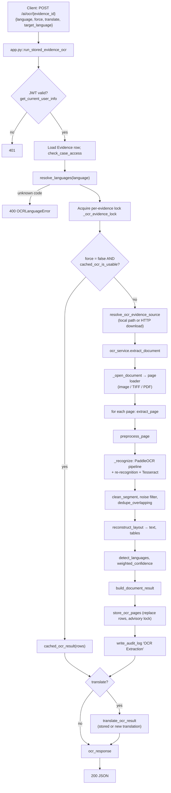
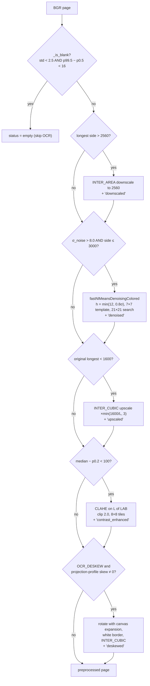
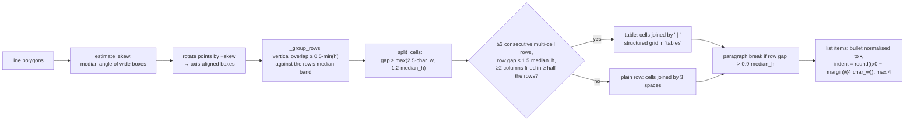
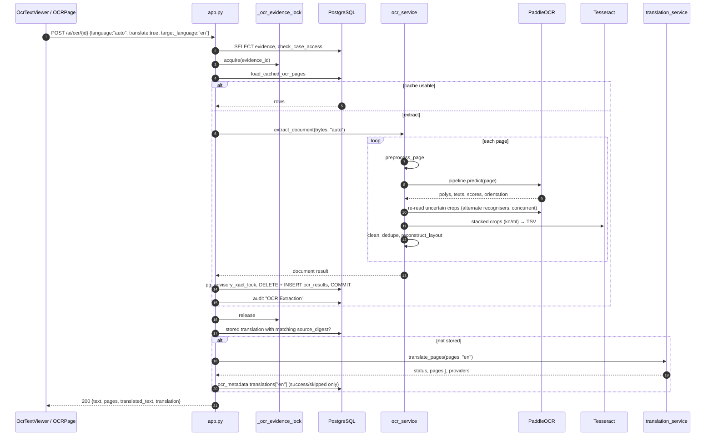
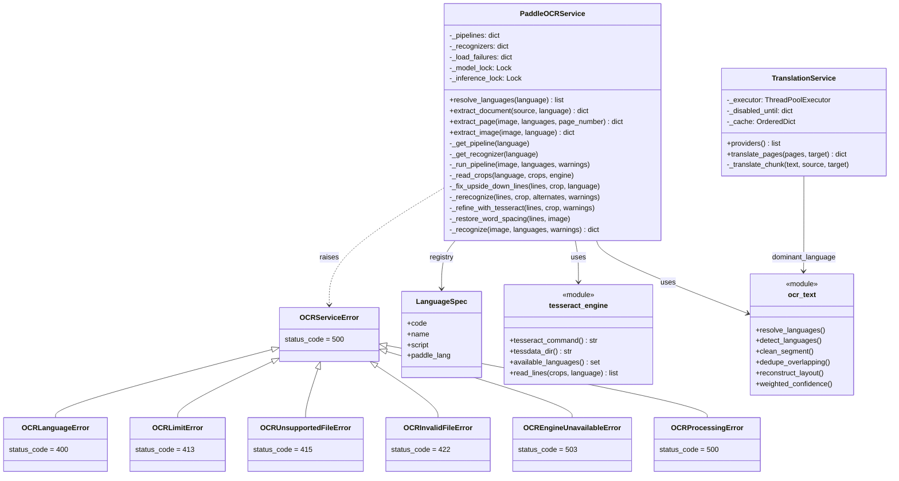
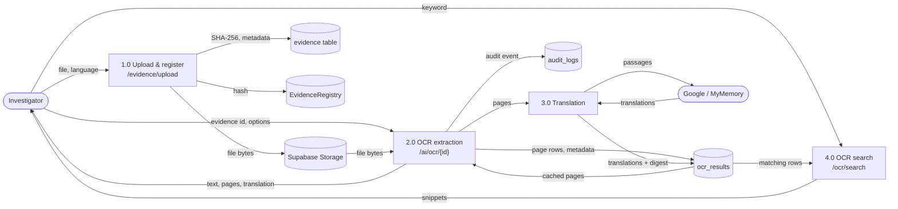

# Chapter 2 — OCR Module

## 2.1 What it is and why it is needed

The OCR module converts documentary evidence (FIR copies, seized papers, screenshots, scanned PDFs) into page-wise, searchable, optionally translated text. It must handle:

- six languages in five scripts: English (Latin), Hindi (Devanagari), Kannada, Telugu, Tamil, Malayalam, including lines that mix scripts;
- degraded capture: phone photographs, low-resolution photocopies, skew, rotation, noise, faded ink;
- multi-page inputs (PDF, multi-frame TIFF);
- evidentiary constraints: the extracted text must never be fabricated, and the raw engine output is retained.

## 2.2 Folder structure

```
backend/
├── app.py                          # OCR endpoints, caching, storage, translation orchestration
├── models.py                       # OCRResult ORM model (table ocr_results)
├── migrate_ocr_results.py          # operator migration: columns, de-duplication, unique index
├── setup_tessdata.py               # downloads Tesseract tessdata_best models into backend/tessdata
├── tessdata/                       # (git-ignored) eng/hin/kan/mal/tel/tam .traineddata
├── requirements.txt                # paddleocr>=3.7,<4 ; pypdfium2 ; deep-translator ; opencv ; pillow …
├── .env.example                    # OCR_* / TRANSLATION_* / TESSERACT_* configuration
├── services/
│   ├── ocr_service.py              # engine orchestration, input loading, preprocessing, recognition
│   ├── ocr_text.py                 # language registry, script detection, cleaning, layout reconstruction
│   ├── tesseract_engine.py         # Tesseract line recogniser (batched, TSV)
│   └── translation_service.py      # provider chain, segmentation, caching
└── tests/
    ├── test_ocr_text.py            # 25 unit tests: languages, cleaning, layout, confidence
    ├── test_ocr_engine_rules.py    # 6 unit tests: digit restoration, missing-script rule
    └── test_translation.py         # 9 unit tests: provider fallback, statuses, limits
audit-frontend/src/
├── pages/OtherPages.tsx            # OCRPage (upload + OCR), EvidencePage
├── pages/CaseDetail.tsx            # "OCR Analysis" tab
├── components/OcrTextViewer.tsx    # page tabs, original/translated toggle, copy/download
└── services/api.ts                 # runOCR(), searchOCR()
```

## 2.3 End-to-end execution flow



## 2.4 Input handling (`ocr_service.py`)

### 2.4.1 Evidence retrieval (`app.py::resolve_ocr_evidence_source`)

The evidence row stores `file_url`. Two storage modes exist (`USE_LOCAL_STORAGE` in `app.py`):

- **Supabase Storage (remote).** The file is streamed with `requests.get(..., stream=True, timeout=(10, 60))` in 1 MiB chunks. The download aborts with HTTP 413 once it exceeds `OCR_MAX_FILE_BYTES` (default 52 428 800). Network errors map to HTTP 502.
- **Local storage.** URLs containing `/uploads/` are mapped to `backend/uploads/…`. A `commonpath` check rejects paths escaping the uploads root (path traversal, HTTP 400). A missing file returns 404.

### 2.4.2 Type sniffing and validation (`_read_source`, `_is_pdf`, `_open_document`)

| Check | Rule | Error (HTTP) |
|---|---|---|
| Empty file | `len(data) == 0` | `OCRInvalidFileError` (422) |
| Size limit | `> OCR_MAX_FILE_BYTES` | `OCRLimitError` (413) |
| PDF detection | magic bytes `%PDF-` within the first 1024 bytes (the PDF specification allows leading junk) | — |
| Image decoding | `PIL.Image.open` + `load()` | `UnidentifiedImageError` → `OCRUnsupportedFileError` (415); `OSError/SyntaxError/ValueError` → `OCRInvalidFileError` (422) |
| Decompression bomb | Pillow `DecompressionBombError` | `OCRLimitError` (413) |
| Degenerate image | width or height < 2 px | `OCRInvalidFileError` (422) |
| Page limit | `> OCR_MAX_PDF_PAGES` (default 50) for PDF and multi-frame TIFF | `OCRLimitError` (413) |

Type is decided by content (magic bytes / decoder), not by file extension.

### 2.4.3 Image normalisation (`_pil_to_bgr`)

1. `ImageOps.exif_transpose`: applies the EXIF orientation tag written by phone cameras.
2. 16/32-bit images (`I;16`, `I`, `F` modes) are linearly stretched to 8 bits: $v' = 255\,(v-v_{min})/(v_{max}-v_{min})$.
3. Transparent images (`RGBA`, `LA`, `PA`, palette with transparency) are alpha-composited onto white. Transparent pixels would otherwise become black.
4. Conversion to OpenCV's BGR channel order, which PaddleX assumes for `ndarray` input.

### 2.4.4 PDF handling (`_open_pdf`, `_open_pdf_with_poppler`)

- **Primary renderer: PDFium via `pypdfium2`.** No external binary is needed. Each page is rendered on demand (lazy `load_page(index)`), so memory is bounded by one page. The render scale is

$$s = \max\!\left(1,\ \min\!\left(\frac{\mathrm{DPI}}{72},\ \frac{D_{max}}{\max(w_{pt}, h_{pt})}\right)\right),\qquad \mathrm{DPI}=300,\ D_{max}=2560,$$

  so pages are rendered at up to 300 dpi but never larger than the OCR working resolution. PDFium is not thread-safe, so every call is serialised by `_PDFIUM_LOCK`. A password-protected PDF raises `OCRInvalidFileError` ("password-protected"); a corrupted PDF raises `OCRInvalidFileError`.
- **Fallback renderer: `pdf2image` + Poppler.** Used only if `pypdfium2` is not importable (`POPPLER_PATH` configures the binary).
- **Text layer:** **Not implemented.** Embedded PDF text layers are not read. Every PDF page is rasterised and OCR'd, which also defeats text layers produced in legacy Indic fonts.

### 2.4.5 Multi-page TIFF

For `image.format == "TIFF"` the page count is `n_frames`, and `load_page` seeks to each frame. Animated GIFs are treated as a single page.

## 2.5 Image preprocessing (`preprocess_page`)

PaddleOCR's DBNet detector and CRNN/SVTR recognisers are trained on natural colour images, so global binarisation is deliberately not applied to the OCR input. Every enhancement is **conditional**, and the steps applied are reported in the page field `preprocessing`.



### 2.5.1 Blank-page detection (`_is_blank`)
A page is blank when the grey-level standard deviation is below 2.5 **and** the 0.5–99.5 percentile range is below 16. Blank pages skip recognition and are reported with `status: "empty"`.

### 2.5.2 Resolution normalisation
- **Downscaling** when the longest side exceeds `OCR_MAX_IMAGE_DIM` (2560), using area interpolation (anti-aliasing).
- **Upscaling** for low-resolution scans when the longest side is below `OCR_MIN_IMAGE_DIM` (1600), by $f = \min(1600/L,\,3)$ with bicubic interpolation. The ×3 cap limits the cost of inventing pixels.

Denoising runs *before* upscaling so that noise is not magnified first.

### 2.5.3 Noise estimation and removal (`_noise_sigma`)
Noise is estimated with Immerkær's fast method, restricted to low-gradient pixels so that text edges do not inflate the estimate (Section 2.16.9). If $\hat\sigma > 8$ (`OCR_DENOISE_THRESHOLD`) and the image side is at most 3000 px, OpenCV non-local-means denoising is applied with filter strength $h=\min(12,\,0.8\hat\sigma)$.

### 2.5.4 Contrast enhancement
The contrast is measured between paper and ink as $\Delta = \operatorname{median}(I) - P_{0.2}(I)$. A global percentile range is deliberately not used, because it misjudges clean, mostly white pages. If $\Delta < 100$, CLAHE (contrast-limited adaptive histogram equalisation) is applied to the L channel of CIE-LAB with clip limit 2.0 on an 8×8 tile grid. Hue is preserved.

### 2.5.5 Deskewing (`_estimate_page_skew`, `_rotate`)
Projection-profile analysis (Section 2.16.7):
1. The page is downsampled to 800 px and Otsu-binarised (ink = 1). This binarisation is used only for estimation.
2. Pages with an ink ratio outside [0.5 %, 30 %] (photographs, near-blank pages) are skipped.
3. The binary image is padded to its diagonal so that rotations do not clip corners.
4. A coarse search runs over $[-45°, 45°]$ in 1° steps, then a fine search over ±1° around the best angle in 0.1° steps. Each candidate maximises the variance of the row-sum profile.
5. The page is rotated only if $|\theta^*|\ge 0.3°$ and the profile variance improves by at least 15 % over 0°.
6. The rotation expands the canvas to the rotated bounding box and fills with white.

Turns of 90°, 180° and 270° are left to the PaddleOCR document-orientation classifier (Section 2.6).

### 2.5.6 Rotation correction — three mechanisms

| Mechanism | Handles | Implementation |
|---|---|---|
| EXIF orientation | camera metadata rotation | `ImageOps.exif_transpose` |
| Document orientation classifier `PP-LCNet_x1_0_doc_ori` | 0/90/180/270° page rotation | PaddleOCR pipeline flag `use_doc_orientation_classify=True` (`OCR_DOC_ORIENTATION`) |
| Projection-profile deskew | arbitrary tilt within ±45° | `_estimate_page_skew` |
| Per-line flip test | individual upside-down lines | `_fix_upside_down_lines` (Section 2.7.4) |

PaddleOCR's text-line orientation classifier (`PP-LCNet_x1_0_textline_ori`) is **disabled by default** (`OCR_TEXTLINE_ORIENTATION=false`). Measured on this project's Hindi pages, it classified every upright Devanagari line as upside down (orientation class 1 for all four lines), which flipped the crops and produced gibberish.

### 2.5.7 Perspective correction
- **Page-level perspective (keystone) correction:** **Not implemented.** PaddleOCR's document unwarping model (UVDoc) is available, but it is disabled by default (`OCR_DOC_UNWARPING=false`) because it can degrade flat scans.
- **Line-level perspective rectification:** **Implemented.** Each detected text line is a quadrilateral, and `_crop_line` maps it to an axis-aligned rectangle with a homography (`cv2.getPerspectiveTransform` + `warpPerspective`, Section 2.16.6). This mirrors PaddleOCR's internal `get_rotate_crop_image`. A crop taller than 1.5× its width is additionally rotated 90° (vertical text).

## 2.6 Text-region detection

- **Model:** `PP-OCRv5_mobile_det` (a DBNet-family differentiable-binarisation detector). It is configurable through `OCR_DET_MODEL`, and `PP-OCRv6_medium_det` is recommended on CUDA hosts.
- **Pipeline construction:** `PaddleOCRService._get_pipeline(language)` builds `paddleocr.PaddleOCR(text_detection_model_name=…, text_recognition_model_name=RECOGNITION_MODELS[language], use_doc_orientation_classify, use_doc_unwarping, use_textline_orientation)`. One pipeline is cached per primary language.
- **Output parsed (`_recognize`, `_result_dict`):** `rec_texts`, `rec_scores`, `rec_polys` (4-point quadrilaterals), `textline_orientation_angles`, and `doc_preprocessor_res.output_img` / `.angle`. Polygons refer to the orientation-corrected image, so all later crops are taken from `output_img`.
- **Detector parameters** (PaddleX defaults, not overridden): `limit_side_len=64`, `limit_type='min'`, `thresh=0.3`, `box_thresh=0.6`, `unclip_ratio=1.5`, `max_side_limit=4000`.

## 2.7 Recognition: hybrid PaddleOCR + Tesseract

### 2.7.1 Language registry (`ocr_text.SUPPORTED_LANGUAGES`, `ocr_service.RECOGNITION_MODELS`)

| ISO code | Script | PaddleOCR recogniser (default) | Tesseract model | Final text engine |
|---|---|---|---|---|
| `en` | Latin | `en_PP-OCRv5_mobile_rec` | `eng` | PaddleOCR |
| `hi` | Devanagari | `devanagari_PP-OCRv5_mobile_rec` | `hin` | PaddleOCR |
| `kn` | Kannada | `ka_PP-OCRv3_mobile_rec` | `kan` | **Tesseract** |
| `te` | Telugu | `te_PP-OCRv5_mobile_rec` | `tel` | PaddleOCR |
| `ta` | Tamil | `ta_PP-OCRv5_mobile_rec` | `tam` | PaddleOCR |
| `ml` | Malayalam | *none exists* | `mal` | **Tesseract** |

`OCR_TESSERACT_LANGUAGES` (default `kn,ml`) selects the Tesseract-recognised languages. Client aliases (`eng`, `hin`, `kan`, `tel`, `tam`, `mal`, full names, and `ka` for Kannada) are resolved by `resolve_languages`. `auto` expands to `OCR_AUTO_LANGUAGES` (default `en,hi,kn,te,ta,ml`), and `a+b` or `a,b` specify combinations. The first language is the primary recogniser.

### 2.7.2 Why two engines — the empirical basis
PaddleOCR and Tesseract have complementary accuracy profiles (full data in Chapter 5, [measured] mean CER over five degradations):

| Script | PaddleOCR | Tesseract |
|---|---|---|
| English (dense, small type) | **0.4 %** | 9.2 % |
| Tamil | **1.8 %** | 5.9 % |
| Kannada | 23.4 % | **4.0 %** |
| Malayalam | no model | **10.2 %** (whole page) |

PaddleOCR is also markedly more robust to skew and low resolution in *detection*: Tesseract reading raw skewed or low-resolution pages reached 20–64 % CER. The design therefore uses PaddleOCR for detection, layout and script identification on every page, and hands only the *line crops* of Tesseract-preferred scripts to Tesseract. On those crops Tesseract reached a mean CER of 0.65 % (Malayalam) and 0.91 % (Kannada) (Chapter 5, Table 5.3.2).

Hindi was measured slightly better with Tesseract on synthetic pages (0 % versus 1.5 %). On a real FIR scan, however, Tesseract systematically dropped leading "1" digits ("17:30" → "7:30", "154" → "54") where PaddleOCR's Devanagari model read them correctly, so Hindi stays on PaddleOCR (`_refine_with_tesseract` docstring).

### 2.7.3 Primary pass (`_run_pipeline`)
The first requested language that has a PaddleOCR model and loads successfully becomes the primary pipeline. If no requested language has a PaddleOCR model (a Malayalam-only request), English is used as a *carrier* for detection only (Section 2.7.6).

### 2.7.4 Upside-down line test (`_fix_upside_down_lines`)
Every line whose confidence is below 0.85 is re-read rotated 180° with the primary recogniser. The flipped reading replaces the original only when its score is both ≥ 0.85 and at least 0.10 above the original. The absolute bar prevents an upright line in another script, which reads poorly either way up, from being flipped.

### 2.7.5 Script identification by competitive re-recognition (`_rerecognize`)
For each line $i$ with primary reading $(t_i, c_i)$ in language $\ell_i$:

1. **Uncertain set.** Lines with reading score $R(t_i,c_i,\ell_i) < 0.93$ (`OCR_LANGUAGE_RECHECK_THRESHOLD`), where $R$ is defined in Section 2.16.2.
2. **Concurrent reading.** All alternate languages read the uncertain crops **concurrently** (`ThreadPoolExecutor`). Tesseract runs in separate processes, and PaddleOCR releases the GIL during inference. Tesseract-preferred languages are read with Tesseract, the others with their PaddleOCR recogniser.
3. **Acceptance.** An alternate reading $(t', c')$ in language $\ell'$ replaces the current one when all of the following hold:
   - own-script ratio $\rho_{\ell'}(t') \ge 0.2$ (the Hindi model reading an English line produces Latin output and is rejected);
   - for non-English $\ell'$, at least 3 letters of $\ell'$'s script (1–2 glyph readings of stamps or specks are not evidence of a script);
   - $R(t',c',\ell') > R(t_i,c_i,\ell_i) + 0.02$, **or** the *missing-script rule* $\mathrm{AddsMissing}(t_i, t', c', \ell')$ holds (Section 2.16.3).
4. **Mixed-page escalation.** If a language won at least one uncertain line (the page is mixed), the remaining confident lines are also compared against that language. This catches confident-but-wrong primary readings, such as an English model silently dropping the Devanagari inside "District (जिला): ROURKELA".

### 2.7.6 Carrier mode
When the pipeline language was not requested, its readings are given confidence 0 during comparison, so any requested-language reading wins. Afterwards the carrier's original confidence is restored for lines no other language claimed.

### 2.7.7 Tesseract refinement (`_refine_with_tesseract`, `tesseract_engine.read_lines`)
Lines assigned to a Tesseract-preferred language and not yet read by Tesseract are re-read in **one Tesseract invocation per language per page**:

- each crop is converted to grey and scaled to a height of 64 px (maximum ×4), which puts the x-height in the 20–30 px range Tesseract's LSTM models expect;
- crops are stacked vertically with 24 px padding and 40 px gaps into one "sheet" image;
- Tesseract runs with `--oem 1` (LSTM), `--psm 6` (single uniform block), `-l <lang>+eng` (the Indic model combined with English, because Indian documents mix English words into Indic lines), and `-c tessedit_create_tsv=1` (a parameter rather than the `tsv` config file, which is missing from custom `--tessdata-dir` folders);
- TSV words (level 5) are mapped back to crops by the band containing each word's vertical centre, then sorted by x;
- line confidence is the character-length-weighted mean of word confidences, divided by 100.

A Tesseract reading replaces PaddleOCR's only if it is non-empty, has confidence ≥ 0.3, and has own-script ratio ≥ 0.5. It then passes through `restore_dropped_digits` (Section 2.16.4).

Tesseract is optional. `available_languages()` runs `tesseract --list-langs` (cached per configuration). If data is missing, PaddleOCR's reading is kept and a warning is returned (e.g. "Kannada was read with PaddleOCR because Tesseract 'kan' data is not installed (lower accuracy)"). If a language has no PaddleOCR model at all, it is reported unrecognised.

### 2.7.8 Word-spacing restoration (`_restore_word_spacing`, `_split_word_crops`)
PaddleOCR's `ka_PP-OCRv3` model rarely emits spaces (`SPACE_POOR_LANGUAGES=("kn",)`). This only matters when Kannada falls back to PaddleOCR. For space-less lines of at least 6 characters, the crop is split at blank column runs wider than $\max(0.22\,h,\ 2\cdot\operatorname{median}(\text{gap widths}))$. Kannada aksharas are often disconnected, so ordinary intra-word gaps must be excluded. Each word is recognised separately and the words are joined with spaces. The result is accepted if its weighted confidence is no more than 0.05 below the original.

## 2.8 Post-recognition text processing (`ocr_text.py`)

### 2.8.1 Segment cleaning (`clean_segment`)
Applied to each line, in order:

1. Unicode NFC normalisation.
2. Removal of control, private-use, unassigned and invisible *format* characters (Unicode categories Cc, Co, Cn, Cf) and U+FFFD. **ZWJ and ZWNJ are kept**, because they change Indic conjunct rendering.
3. Removal of CJK characters (any recogniser with a Chinese dictionary can emit them on smudges). Full-width ASCII is folded with NFKC.
4. `fix_indic_confusions`:
   - an Indic digit zero (Devanagari ०, Kannada ೦, Telugu ౦, Malayalam ൦) directly after a letter or vowel sign of the same script block is replaced by that script's anusvara (a real number such as "೧೦" is untouched);
   - legacy Malayalam chillu sequences (consonant + virama + ZWJ, emitted by Tesseract) are mapped to atomic chillu letters (U+0D7A–U+0D7F);
   - ZWNJ/ZWJ after a virama at the end of a word is removed.
5. Runs of more than three identical punctuation marks are collapsed to three.
6. Leading and trailing table-rule characters (`| ¦ │ ┃`) are stripped, and whitespace is collapsed.
7. Immediately repeated words of at least two letters are collapsed, case-insensitively (`OCR_COLLAPSE_DUPLICATE_WORDS`). Repeated numbers and initials are left alone.

### 2.8.2 Noise filtering
A line is discarded when its confidence is below 0.35 (`OCR_MIN_LINE_CONFIDENCE`), or when `is_noise_segment` holds:

| Content characters | Discard when |
|---|---|
| 0 (symbols only) | length ≤ 3 or confidence < 0.8 |
| 1 | confidence < 0.9 |
| 2–3 | confidence < 0.7 |

### 2.8.3 Duplicate detection removal (`dedupe_overlapping`)
Boxes are processed in descending confidence. A box is dropped if it overlaps an already-kept box with overlap ratio > 0.6 (Section 2.16.10) **and** its text is similar: containment, or `SequenceMatcher` ratio ≥ 0.8.

### 2.8.4 Layout reconstruction (`reconstruct_layout`)



Row membership uses the *median* top and bottom of a row, not min/max, so a single tall box (slanted handwriting, a stamp) cannot stretch a row until it swallows the rows below. Horizontally adjacent segments whose boxes overlap drop a word duplicated across the boundary (`_join_segments`).

## 2.9 Language and script detection

- **Script of a character** (`char_script`) comes from Unicode block ranges: Latin, Devanagari (U+0900–097F, U+A8E0–A8FF), Kannada (U+0C80–0CFF), Telugu (U+0C00–0C7F), Tamil (U+0B80–0BFF), Malayalam (U+0D00–0D7F), plus Bengali, Arabic, Cyrillic and CJK for rejection purposes. Digits are script-neutral.
- **Detected languages** (`detect_languages`): for text $T$, let $n_s$ be the number of characters of supported script $s$ and $N=\sum_s n_s$. Language $s$ is reported when $n_s/N \ge 0.05$ **or** $n_s \ge 20$, so a few English sentences inside a long Hindi FIR are still reported. The list is sorted by $n_s$, and each entry is `{code, name, ratio, char_count}`.
- **Language label** (`language_label`): codes joined by "+" (e.g. `"en+hi"`), or `"unknown"`.
- **Line language:** the dominant script of the cleaned line, or the model language for script-neutral lines.

This is script detection mapped to languages. Hindi, Marathi and Nepali (all Devanagari) are therefore not distinguished. No statistical n-gram language identifier is used.

## 2.10 Translation pipeline (`translation_service.py`)

### 2.10.1 Providers and fallback
- **Order:** providers are tried in the order of `TRANSLATION_PROVIDERS` (default `google,mymemory`), both through the `deep-translator` package.

  | Provider | Access | Per-request limit | Source language |
  |---|---|---|---|
  | `google` | Google Translate web endpoint, keyless | 1800 chars / 12 000 URL-encoded bytes (text travels in the URL; an Indic character costs ≈9 bytes) | may be `auto` |
  | `mymemory` | MyMemory API, keyless (`MYMEMORY_EMAIL` raises the daily quota) | 450 chars / 4500 bytes | must be explicit (locale codes `hi-IN`, `kn-IN`, `en-GB`, …) |

- **Circuit breaker:** a provider that times out (`TRANSLATION_TIMEOUT_SECONDS`, default 20, enforced with a `ThreadPoolExecutor` future timeout), is rate-limited (`TooManyRequests`), exhausts its quota, or cannot be reached is paused for 300 s (`PROVIDER_COOLDOWN_SECONDS`).
- **Quota detection:** MyMemory returns HTTP 200 with a "MYMEMORY WARNING…" string as the *translation* when its quota is exhausted. This is detected and treated as `QuotaExceeded`, never displayed.
- **No match:** MyMemory raises `StopIteration` when it has no translation (typically for OCR gibberish). This is mapped to `NoTranslationFound`, and the passage is kept in the original language. It is not counted as a provider failure.

[measured] During this work the Google endpoint returned HTTP 429 with an "unusual traffic" CAPTCHA page for the development network from the first request. MyMemory served all translations.

### 2.10.2 Segmentation (`_segments`)
Page text is split on newlines. Consecutive lines of the same detected language merge into one unit while the unit stays within the *smaller* provider limit. Blank lines and lines without letters (dates, numbers) are units with no source language and are never sent. Over-long lines are split at spaces (`_split_long_line`). This preserves line breaks and paragraphs, and it sends every passage with the correct source language, which makes mixed-language pages work with MyMemory.

### 2.10.3 Statuses
- `skipped`: nothing to translate (the text is already in the target language, or has no letters);
- `success`: every sendable passage was translated or had no available translation;
- `partial`: some passages failed; those passages keep their original text;
- `failed`: every attempted passage failed.

`error` carries a plain-language reason, `message` notes untranslated passages, and `untranslated_passages` counts them. Documents over `TRANSLATION_MAX_CHARS` (30 000) are refused.

### 2.10.4 Caching
- **In-memory:** an LRU of 2000 entries keyed by $\mathrm{SHA256}(\text{source} \,\|\, \text{">"} \,\|\, \text{target} \,\|\, \text{0x00} \,\|\, \text{text})$.
- **Persistent:** successful or skipped translations are stored per page in `ocr_results.ocr_metadata.translations[<target>]` together with `source_digest = SHA256(page text)` (`app.py::translate_ocr_result`). A stored translation is reused only while the digest matches the current page text. The original `extracted_text` column is never modified.

## 2.11 Result caching and de-duplication (`app.py`)

- **Cache hit** (`cached_ocr_is_usable`): stored rows exist, contain none of the legacy placeholder strings, have no page with `status == "failed"`, and either the request is `auto` or the stored `requested_languages` equal the requested set. An explicit request for a different language re-extracts and *replaces* the rows.
- **Legacy duplicates** (`load_cached_ocr_pages`): the most recent row per `page_number` is used.
- **Concurrency:**
  - an in-process lock per evidence ID (`_ocr_evidence_lock`) makes a concurrent request wait and then hit the cache;
  - `store_ocr_pages` takes a PostgreSQL transaction-scoped advisory lock, `pg_advisory_xact_lock(hashtext('ocr:<uuid>'))`, then deletes and re-inserts the evidence's rows in one transaction;
  - the migration adds a unique index on `(evidence_id, page_number)` (Chapter 3).
- **`force=true`** bypasses the cache and replaces the rows.

## 2.12 Confidence computation

- **Line confidence:** the recogniser score. For PaddleOCR this is CTC/attention sequence confidence in [0, 1]. For Tesseract it is the length-weighted mean word confidence / 100.
- **Page and document confidence** (`weighted_confidence`): character-weighted means (Section 2.16.1), so a long, accurately read paragraph outweighs short specks.
- **Empty pages** contribute zero weight.

## 2.13 Response structure (fresh extraction)

Values below are from the measured run on the bilingual FIR sample `fir1.jpg` (768×1024 px); `…` marks elided values.

```json
{
  "success": true,
  "message": "OCR completed successfully.",
  "data": {
    "evidence_id": "…",
    "text": "full text, pages joined by blank lines",
    "extracted_text": "same as text (legacy)",
    "confidence": 0.9599,
    "language": "en+hi",
    "detected_language": "en+hi",
    "detected_languages": [{"code": "en", "name": "English", "ratio": 0.6166, "char_count": 447},
                           {"code": "hi", "name": "Hindi", "ratio": 0.3834, "char_count": 278}],
    "requested_languages": ["en", "hi", "kn", "te", "ta", "ml"],
    "pages": [{
      "page_number": 1, "status": "success", "text": "…", "raw_text": "…",
      "confidence": 0.9599, "language": "en+hi", "detected_languages": [ … ],
      "line_count": "…", "lines": [{"text": "…", "confidence": 0.97, "language": "en",
                                   "engine": "paddle", "bbox": [[x,y],[x,y],[x,y],[x,y]]}],
      "tables": [{"rows": [["2","IPC 1860","147"], "…"], "row_count": 9, "column_count": 3}],
      "warnings": [], "width": 768, "height": 1024, "scale": 1.5625,
      "rotation": 0, "skew_angle": 0.0, "preprocessing": ["upscaled"],
      "processing_time_ms": "…",
      "translated_text": null
    }],
    "total_pages": 1,
    "processing_time_ms": 45500,
    "warnings": [],
    "cached": false,
    "translated_text": null,
    "translation": null
  }
}
```

| Field | Meaning |
|---|---|
| `text` / `extracted_text` | Cleaned, layout-reconstructed text. Both keys are kept for frontend compatibility. |
| `confidence` | Character-weighted document confidence ∈ [0, 1]. |
| `language` / `detected_language` | Language label (`"hi+en"`, `"unknown"`). |
| `detected_languages` | Supported languages present, with share and character count. |
| `requested_languages` | Resolved candidate list. |
| `pages[].status` | `success`, `empty` (blank or no text) or `failed` (with `error`). |
| `pages[].raw_text` | Unmodified recogniser output, one line per detection, before cleaning. Kept for audit. |
| `pages[].lines[]` | Per line: text, confidence, language, `engine` (`paddle`/`tesseract`) and `bbox` quadrilateral in the preprocessed, orientation-corrected frame (divide by `scale` for original pixels). |
| `pages[].tables` | Detected tables as a grid of cell strings. |
| `pages[].rotation` | Page rotation applied by the orientation classifier (0/90/180/270). |
| `pages[].skew_angle` | Degrees corrected by deskew. |
| `pages[].preprocessing` | Enhancements applied. |
| `processing_time_ms` | Wall-clock time of the request (0 for a cached extraction's page processing). |
| `cached` | True when served from stored rows. |
| `translated_text`, `translation`, `pages[].translated_text` | Present when `translate=true` (Section 2.10). `translation` holds `status`, `target_language`, `source_languages`, `providers`, `error`, `message`, `cached`. |

## 2.14 Frontend rendering

- `OtherPages.tsx::OCRPage`: select a case, choose a language mode (Auto-detect, English, Hindi, Kannada, Telugu, Tamil, Malayalam, English+Hindi, English+Kannada), and upload. The page uploads the file through `api.uploadEvidence` (registering it on-chain) and then calls `api.runOCR(evidenceId, language)`. A 409 duplicate upload is resolved to the existing evidence ID parsed from the response.
- `CaseDetail.tsx` (OCR Analysis tab): runs OCR on existing evidence and shows a summary (language, detected languages with percentages, confidence colour-coded at 0.8/0.5, pages, processing time or "Cached result", warnings).
- `components/OcrTextViewer.tsx`: shared viewer with page tabs, an Original/Translated toggle, a target-language selector (default English), a translate action that calls `runOCR(…, {translate: true, target_language})`, status banners (failed / partial / skipped / info), a "machine translation — verify against the original" notice, and copy/download of the current view. Text renders in a monospace `pre-wrap` block so reconstructed layout survives.
- `api.ts::runOCR` sets a 300 s Axios timeout.

## 2.15 Error handling and logging

| Exception (`ocr_service.py`) | HTTP | Typical cause |
|---|---|---|
| `OCRLanguageError` | 400 | unknown language code |
| `OCRLimitError` | 413 | file, page-count or pixel limits |
| `OCRUnsupportedFileError` | 415 | not an image or PDF |
| `OCRInvalidFileError` | 422 | empty, truncated, corrupted or password-protected |
| `OCREngineUnavailableError` | 503 | PaddleOCR not installed, no model loadable |
| `OCRProcessingError` | 500 | every page failed |

A failing page yields `status: "failed"` with `error`, and the other pages still complete (`extract_document`). Model load failures are logged and retried after 300 s. Logging uses the `backend.ocr`, `backend.ocr.tesseract` and `backend.translation` loggers; request-level events are printed with an `[OCR]` prefix in `app.py`. Audit entries: "OCR Extraction" with evidence ID, file name, confidence, pages, languages and the forced flag.

## 2.16 OCR mathematics

### 2.16.1 Character-weighted confidence
For readings $(t_j, c_j)$ with $w_j = |{\rm strip}(t_j)|$:

$$C = \frac{\sum_j w_j\, c_j}{\sum_j w_j},\qquad C = 0 \text{ if } \sum_j w_j = 0.$$

This is used at line-set (page) level and at page-set (document) level (`weighted_confidence`). Tesseract line confidence uses the same form over words, with $c_j = \mathrm{conf}_j/100$.

### 2.16.2 Script ratios and reading score
Let $n_s(t)$ be the number of characters of script $s$ in $t$ and $N(t) = \sum_s n_s(t)$. Let $S(\ell)$ be the script of language $\ell$.

- **Native-script ratio** (`native_script_ratio`), which treats Latin as native to every model because the Indic dictionaries include Latin:
$$\nu_\ell(t) = \frac{n_{S(\ell)}(t) + n_{\text{latin}}(t)\,[\ell \ne \text{en}]}{N(t)},\qquad \nu_\ell(t)=1 \text{ if } N(t)=0.$$
- **Own-script ratio** (`_own_script_ratio`): $\rho_\ell(t) = n_{S(\ell)}(t)/N(t)$ (0 if $N=0$).
- **Reading score** (`_reading_score`): confidence discounted by foreign-script output,
$$R(t, c, \ell) = c\,\bigl(0.5 + 0.5\,\nu_\ell(t)\bigr).$$

### 2.16.3 Missing-script rule
With $L(t)$ the case-folded ASCII alphanumerics of $t$ and $\mathrm{sim}$ the Ratcliff/Obershelp ratio (`difflib.SequenceMatcher`),

$$\mathrm{AddsMissing}(t, t', c', \ell') \iff \ell'\ne\text{en}\ \wedge\ c'\ge 0.7\ \wedge\ n_{S(\ell')}(t)=0\ \wedge\ n_{S(\ell')}(t')\ge 2\ \wedge\ |L(t)|\ge 3\ \wedge\ \mathrm{sim}(L(t),L(t'))\ge 0.8,$$

where $\mathrm{sim}(a,b) = 2M/(|a|+|b|)$ and $M$ is the number of matched characters.

### 2.16.4 Dropped-digit restoration
Let $D(t) = (d_1,\dots,d_m)$ be the maximal digit runs of $t$. The runs of the Tesseract reading $D(t_T)$ and of the PaddleOCR reading $D(t_P)$ are aligned by `SequenceMatcher`. In every *replace* block, pairs are right-aligned, and run $d$ is replaced by $d'$ iff $|d'| > |d|$ and $d'$ ends with $d$. Example: $(28,03,2022,7,30)$ against $(7,28,03,2022,17,30)$ restores $7\to 17$.

### 2.16.5 Image scaling
- **Downscale:** $s = D_{max}/L$. **Upscale:** $f = \min(D_{min}/L, 3)$, where $L$ is the longest side.
- Bounding boxes are reported in the scaled frame; original coordinates are $x_{orig} = x/s$.

### 2.16.6 Affine rotation and perspective rectification
- **Rotation about the centre $(c_x, c_y)$ by angle $\theta$** (`cv2.getRotationMatrix2D`, scale 1):
$$M=\begin{bmatrix}\cos\theta & \sin\theta & (1-\cos\theta)c_x - \sin\theta\, c_y\\ -\sin\theta & \cos\theta & \sin\theta\, c_x + (1-\cos\theta)c_y\end{bmatrix},\qquad \begin{bmatrix}x'\\y'\end{bmatrix} = M\begin{bmatrix}x\\y\\1\end{bmatrix}.$$
- **Canvas expansion** in `_rotate`: $W' = \lfloor h|\sin\theta| + w|\cos\theta|\rfloor$ and $H' = \lfloor h|\cos\theta| + w|\sin\theta|\rfloor$, with translation $M_{13} \mathrel{+}= W'/2 - w/2$ and $M_{23} \mathrel{+}= H'/2 - h/2$.
- **Line rectification** (`_crop_line`) solves the homography $H\in\mathbb{R}^{3\times3}$ mapping the quadrilateral $\{p_k\}$ to the rectangle $\{(0,0),(W,0),(W,H),(0,H)\}$, where $W=\max(\|p_0p_1\|,\|p_2p_3\|)$ and $H=\max(\|p_0p_3\|,\|p_1p_2\|)$:
$$\begin{bmatrix}x'\\y'\\1\end{bmatrix}\sim H\begin{bmatrix}x\\y\\1\end{bmatrix}.$$
- **De-skewing of box coordinates** in `reconstruct_layout`: points are rotated by $-\bar\alpha$, where $\bar\alpha$ is the median angle $\operatorname{atan2}(y_1-y_0,\,x_1-x_0)$ of boxes wider than twice their height.

### 2.16.7 Projection-profile skew estimation
For the binarised image $B_\theta$ rotated by $\theta$, the row profile is $P_\theta(r) = \sum_c B_\theta(r,c)$, and

$$\theta^* = \arg\max_{\theta\in\Theta} \operatorname{Var}_r\bigl[P_\theta(r)\bigr],\qquad \Theta = \{-45,-44,\dots,45\}\ \text{refined to}\ \theta^*\pm1\ \text{in 0.1° steps},$$

accepted iff $|\theta^*|\ge 0.3°$ and $\operatorname{Var}[P_{\theta^*}] \ge 1.15\,\operatorname{Var}[P_0]$. The cost is $O(|\Theta|\cdot n^2)$ for an $n\times n$ image with $n\le 800\sqrt2$ after padding, i.e. about 112 rotations.

### 2.16.8 Otsu thresholding
Used in deskew estimation and word splitting (never for OCR input). The threshold maximises between-class variance:

$$\tau^* = \arg\max_\tau\ \omega_0(\tau)\,\omega_1(\tau)\,\bigl[\mu_0(\tau)-\mu_1(\tau)\bigr]^2.$$

### 2.16.9 Noise estimation (Immerkær, restricted to flat regions)
Convolve with $K = \begin{bmatrix}1&-2&1\\-2&4&-2\\1&-2&1\end{bmatrix}$ and keep pixels whose Sobel gradient magnitude is below the 80th percentile (set $\Omega$):

$$\hat\sigma = \sqrt{\frac{\pi}{2}}\cdot\frac{1}{6|\Omega|}\sum_{(x,y)\in\Omega}\bigl|(I*K)(x,y)\bigr|.$$

### 2.16.10 CLAHE (contrast-limited adaptive histogram equalisation)
Per tile, the histogram $h(k)$ is clipped at $\beta = \text{clip}\cdot\frac{N_{tile}}{256}$ (clip = 2.0), the excess is redistributed uniformly, and the mapping is the scaled CDF:

$$T(k) = \Bigl\lfloor 255\cdot \frac{\sum_{j\le k} \tilde h(j)}{N_{tile}} \Bigr\rfloor,$$

bilinearly interpolated between tile centres. Plain (global) histogram equalisation is the unclipped, single-tile special case.

### 2.16.11 Bounding-box overlap
For axis-aligned boxes $a, b$ in the de-skewed frame (`_overlap_ratio`):

$$\mathrm{ov}(a,b) = \frac{|a\cap b|}{\min(|a|,|b|)}.$$

This is the overlap-over-smaller-area ("intersection over minimum") measure, not IoU. Duplicates require $\mathrm{ov} > 0.6$.

Row membership requires $\min(y_1^{row},y_1^b) - \max(y_0^{row},y_0^b) \ge 0.5\min(h_b,\tilde h_{row})$ with median row bands. The cell-split gap is $g \ge \max(2.5\,\tilde w_{char},\ 1.2\,\tilde h)$, where $\tilde w_{char} = \operatorname{median}_b(w_b/|t_b|)$.

### 2.16.12 Language shares
$r_s = n_s/N$, and language $s$ is reported iff $r_s \ge 0.05 \vee n_s\ge 20$ (Section 2.9). No probabilistic "language confidence" exists; the share $r_s$ is the reported measure.

### 2.16.13 Evaluation metrics (used in Chapter 5; not computed by the application)
- **Character error rate**, with Levenshtein distance $d_L$ (minimum number of insertions, deletions and substitutions) over NFC-normalised, whitespace-collapsed strings:
$$\mathrm{CER}=\frac{d_L(\hat y, y)}{|y|} = \frac{S+D+I}{N}.$$
  $d_L$ is computed by the dynamic programme $D[i][j] = \min(D[i-1][j]+1,\ D[i][j-1]+1,\ D[i-1][j-1]+[\hat y_i\ne y_j])$ in $O(|\hat y|\,|y|)$.
- **Word error rate:** the same formula over word tokens, $\mathrm{WER} = (S_w+D_w+I_w)/N_w$. **Not computed** in this project; it is recommended for future evaluation.
- **Precision, recall, F1** (for detection or character-level matching): $P = TP/(TP+FP)$, $R = TP/(TP+FN)$, $F_1 = 2PR/(P+R)$. **Not computed** for OCR in this project.
- **Character accuracy:** $1-\mathrm{CER}$ (bounded below by 0 in practice).
- **Processing time:** $T = t_{end}-t_{start}$, measured with `time.perf_counter()` per page and per request (`_elapsed_ms`).

### 2.16.14 SHA-256 in the OCR module
SHA-256 (FIPS 180-4) is used for (i) translation cache keys, (ii) `source_digest` binding a stored translation to the exact page text it was made from, and (iii) the evidence file hash that makes the OCR input blockchain-verifiable (Chapter 7). The construction is described in Section 7.12.1.

### 2.16.15 Complexity
For a page with $n$ detected lines, $k$ candidate languages and $u\le n$ uncertain lines:

| Stage | Cost |
|---|---|
| Detection | one CNN forward pass: $O(HW)$ |
| Primary recognition | $n$ crops |
| Re-recognition | $u(k-1)$ crops, plus $(n-u)\cdot|\text{present}|$ on mixed pages; worst case $O(nk)$ recogniser calls |
| Tesseract | one process per Tesseract language |
| Layout | row grouping $O(n\log n)$ (sort) and $O(n)$ grouping; table anchor clustering $O(m\log m)$ over $m$ cells |
| Duplicate removal | $O(n^2)$ pairwise in the worst case |
| Documents | pages processed sequentially: $O(P)$ page passes, memory $O(1)$ pages |

## 2.17 Diagrams

### 2.17.1 Sequence diagram — OCR with translation



### 2.17.2 Class diagram



### 2.17.3 Data-flow diagram (level 1)



## 2.18 Advantages
1. Per-script engine selection backed by measurements instead of a single engine.
2. Robustness to rotation (four mechanisms), tilt up to ±45°, low resolution and noise, with a measured mean CER of 1.18 % across nine synthetic test pages and five degradations (0–1.8 % per script except Telugu, 4.8 %; Chapter 5).
3. Evidentiary hygiene: no fabricated text, raw output retained, typed errors, page-level failure isolation, and idempotent storage.
4. Graceful degradation: missing Tesseract data, missing models or a failed translation provider reduce accuracy or coverage with a visible warning instead of failing.
5. CPU-only operation with MKL-DNN acceleration (Chapter 5).

## 2.19 Limitations
1. No page-level perspective correction. UVDoc is available but disabled.
2. No PDF text-layer extraction.
3. Language identification is script-based; languages sharing a script are not distinguished.
4. Kannada accuracy depends on Tesseract data. Without it, PaddleOCR's older `ka_PP-OCRv3` model gives ≈23 % CER.
5. Very small text (≈5 px, e.g. 450 px-wide photocopies) is unreadable. Upscaling cannot recover the missing information (observed on the `fir2.jpg` sample).
6. Throughput: 2–3 s per English page and 10–40 s per mixed-script page on the reference CPU. There is no asynchronous job queue, so large PDFs exceed the 300 s client timeout (Chapter 5).
7. Translation depends on third-party services. The keyless Google endpoint is unreliable (CAPTCHA observed), the MyMemory free quota is small, and evidence text leaves the system.
8. The benchmark harness used for Chapter 5 is not committed to the repository.

## 2.20 Future improvements
1. Asynchronous OCR jobs with page-level progress (queue + polling or WebSocket) and parallel page processing.
2. PDF text-layer extraction with a legacy-font detector, falling back to OCR.
3. Page dewarping evaluated per input class (enable UVDoc for photographs only).
4. A committed, versioned evaluation set of real FIRs with CER/WER and per-script reporting in CI.
5. Fine-tuned recognisers for Kannada and Malayalam (PaddleOCR v5 architecture) to remove the Tesseract dependency.
6. An on-premise translation model (e.g. IndicTrans2) so evidence text never leaves the system.
7. Hashing `raw_text` and page text on-chain, so OCR output is as tamper-evident as the source file.
