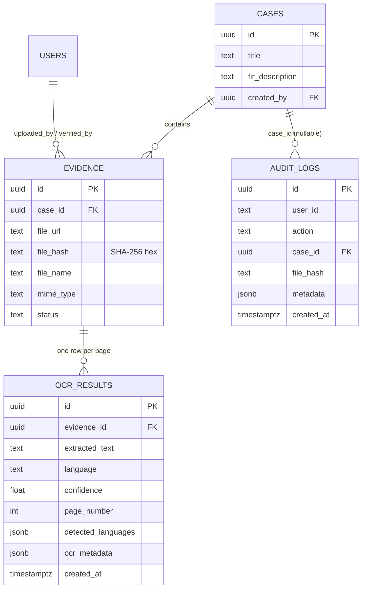
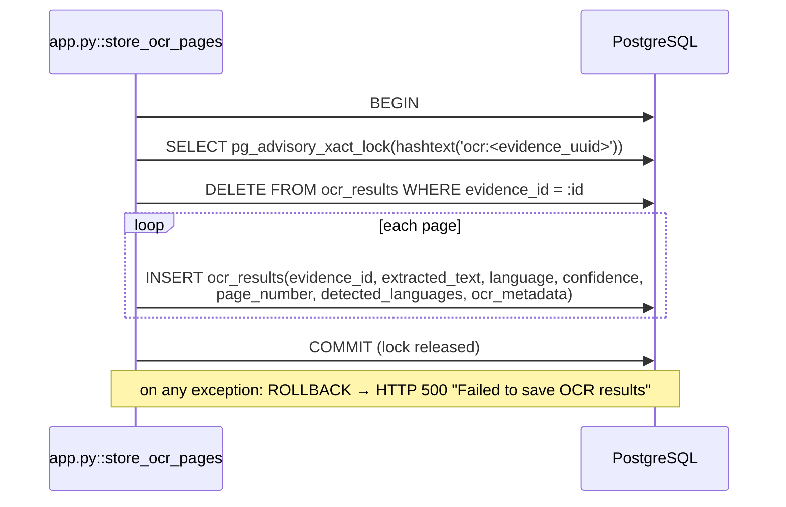

# Chapter 3 — OCR Database

## 3.1 Storage architecture

| Store | Technology | What the OCR module keeps there | Source |
|---|---|---|---|
| Relational database | PostgreSQL (hosted by Supabase), accessed through SQLAlchemy 2 (`backend/db.py`, `backend/models.py`) | OCR results per page, metadata, translations, audit events | `models.py::OCRResult`, `app.py` |
| Object storage | Supabase Storage bucket `evidence` (or `backend/uploads/` when `USE_LOCAL_STORAGE=true`) | The evidence file that OCR reads. OCR writes nothing here. | `app.py::upload_evidence`, `resolve_ocr_evidence_source` |
| In-process memory | Python dictionaries | Loaded models, translation LRU cache, per-evidence locks | `ocr_service.py`, `translation_service.py`, `app.py` |

## 3.2 Table `ocr_results`

Defined by `backend/models.py::OCRResult`, `schema.sql` (section 7) and `backend/migrate_ocr_results.py`.

| Column | Type | Null | Default | Meaning |
|---|---|---|---|---|
| `id` | UUID | no | `gen_random_uuid()` / `uuid.uuid4` | Primary key |
| `evidence_id` | UUID | yes | — | FK → `evidence.id`, `ON DELETE CASCADE` |
| `extracted_text` | TEXT | no | — | Cleaned, layout-reconstructed page text. **Never overwritten by translation.** |
| `language` | TEXT | no | — | Language label of the page, e.g. `hi+en`, `unknown` |
| `confidence` | DOUBLE PRECISION | yes | — | Character-weighted page confidence ∈ [0, 1] |
| `page_number` | INTEGER | no | 1 | 1-based page index |
| `created_at` | TIMESTAMPTZ | no | `now()` | Insertion time |
| `detected_languages` | JSONB | yes | — | Array of `{code, name, ratio, char_count}` |
| `ocr_metadata` | JSONB | yes | — | Page-level details and stored translations (Section 3.4) |

**Indexes and constraints**
- `pk_ocr_results` (id)
- `fk_ocr_results_evidence_id` → `evidence(id)` `ON DELETE CASCADE`
- `idx_ocr_results_evidence_id (evidence_id)`
- `uq_ocr_results_evidence_page UNIQUE (evidence_id, page_number)`, created by `migrate_ocr_results.py` after removing older duplicates. That migration is operator-run, and **it had not yet been applied to the live database** when this report was prepared. Until then, uniqueness relies on the application's replace-in-transaction logic and the advisory lock.

**Schema evolution without downtime.** The FastAPI startup hook `app.py::ensure_ocr_result_columns` runs `ALTER TABLE ocr_results ADD COLUMN IF NOT EXISTS detected_languages JSONB` and the same for `ocr_metadata`. Both columns are nullable, additive and idempotent. De-duplication and the unique index are destructive or blocking, so they are left to the explicit migration.

## 3.3 Relationships



## 3.4 JSON schema of `ocr_metadata`

Written by `app.py::store_ocr_pages` (extraction fields) and `app.py::translate_ocr_result` (translations).

```json
{
  "$schema": "https://json-schema.org/draft/2020-12/schema",
  "title": "ocr_results.ocr_metadata",
  "type": "object",
  "properties": {
    "status":            {"enum": ["success", "empty", "failed"]},
    "error":             {"type": "string", "description": "present when status = failed"},
    "warnings":          {"type": "array", "items": {"type": "string"}},
    "raw_text":          {"type": "string", "description": "unmodified recogniser output, one detection per line"},
    "lines": {
      "type": "array",
      "items": {
        "type": "object",
        "properties": {
          "text":       {"type": "string"},
          "confidence": {"type": "number", "minimum": 0, "maximum": 1},
          "language":   {"type": "string"},
          "engine":     {"enum": ["paddle", "tesseract"]},
          "bbox":       {"type": "array", "items": {"type": "array", "items": {"type": "number"}, "minItems": 2, "maxItems": 2}}
        }
      }
    },
    "tables": {
      "type": "array",
      "items": {"type": "object", "properties": {
        "rows": {"type": "array", "items": {"type": "array", "items": {"type": "string"}}},
        "row_count": {"type": "integer"}, "column_count": {"type": "integer"}}}
    },
    "line_count":          {"type": "integer"},
    "width":               {"type": "integer", "description": "original page width, px"},
    "height":              {"type": "integer"},
    "scale":               {"type": "number", "description": "preprocessing scale; bbox / scale = original px"},
    "rotation":            {"enum": [0, 90, 180, 270]},
    "skew_angle":          {"type": "number", "description": "degrees corrected by deskew"},
    "preprocessing":       {"type": "array", "items": {"enum": ["downscaled", "denoised", "upscaled", "contrast_enhanced", "deskewed"]}},
    "processing_time_ms":  {"type": "integer"},
    "requested_languages": {"type": "array", "items": {"enum": ["en", "hi", "kn", "te", "ta", "ml"]}},
    "document_type":       {"enum": ["image", "pdf"]},
    "translations": {
      "type": "object",
      "description": "keyed by target language code",
      "additionalProperties": {
        "type": "object",
        "properties": {
          "text":             {"type": "string"},
          "source_digest":    {"type": "string", "description": "SHA-256 of extracted_text this translation was made from"},
          "providers":        {"type": "array", "items": {"enum": ["google", "mymemory", "cache"]}},
          "source_languages": {"type": "array", "items": {"type": "string"}},
          "status":           {"enum": ["success", "skipped"]},
          "translated_at":    {"type": "string", "format": "date-time"},
          "message":          {"type": ["string", "null"]}
        }
      }
    }
  }
}
```

## 3.5 Write path



**Properties**
- **Atomicity:** a document's pages are replaced all-or-nothing.
- **Mutual exclusion across worker processes:** the advisory lock. Within one process, `_ocr_evidence_lock` serialises extraction as well.
- **No duplicates:** replace semantics plus the unique index.

**Translation write** (`translate_ocr_result`): for each page row, `ocr_metadata` is copied, `translations[target]` is set, and the whole dictionary is reassigned (`row.ocr_metadata = metadata`) so SQLAlchemy detects the JSONB change. The write happens only for `success` or `skipped` translations, and only when the number of rows equals the number of pages. Failures roll back and are logged; the translation is still returned.

## 3.6 Read paths

| Operation | Query | Source |
|---|---|---|
| Cache lookup | `SELECT * FROM ocr_results WHERE evidence_id=:id ORDER BY page_number ASC, created_at DESC`, then keep the first row per page | `load_cached_ocr_pages` |
| Cache validity | in Python: legacy placeholders, failed pages, language-set equality | `cached_ocr_is_usable` |
| Stored translation | `ocr_metadata.translations[target]` whose `source_digest == SHA256(page text)` | `translate_ocr_result` |
| Search | `ocr_results ⋈ evidence ⟕ cases WHERE extracted_text ILIKE '%q%' ESCAPE '\'`, ordered by `created_at DESC` | `app.py::search_ocr` |

The search query escapes `\`, `%` and `_` in user input before building the `ILIKE` pattern (no SQL injection through LIKE wildcards). The query is parameterised by SQLAlchemy. Snippets are 300 characters starting 100 characters before the first match.

## 3.7 Caching summary

| Cache | Key | Scope | Invalidation |
|---|---|---|---|
| OCR result | `evidence_id` (+ requested language set) | database, permanent | `force=true`, language-set change, legacy placeholder, failed page |
| Translation (persistent) | `(evidence_id, page, target)` + `source_digest` | database | page text changes (digest mismatch), re-extraction (rows replaced) |
| Translation (memory) | `SHA256(source>target\0text)` | process, LRU 2000 | eviction, restart |
| Models | language | process | never (restart) |
| Model load failure | model key | process | retried after 300 s |
| Tesseract languages | `(command, tessdata_dir)` | process | configuration change |

## 3.8 Audit records written by OCR

| Action | When | Metadata |
|---|---|---|
| `OCR Extraction` | fresh extraction stored | `evidence_id`, `filename`, `confidence`, `pages`, `languages`, `forced` |

Cached responses and translations write no audit entry.

## 3.9 Limitations and improvements
- Translations share the `ocr_metadata` JSONB column with extraction metadata. A dedicated `ocr_translations(evidence_id, page_number, target, text, source_digest, provider, created_at)` table would allow indexing and history.
- Re-extraction deletes the previous rows. Earlier extractions (and their translations) are not versioned. For forensic use, an append-only history table would preserve every extraction.
- Search uses `ILIKE` substring matching (sequential scan). PostgreSQL full-text search (`tsvector` + GIN) or `pg_trgm` would scale better, although Indic scripts need a suitable text-search configuration.
