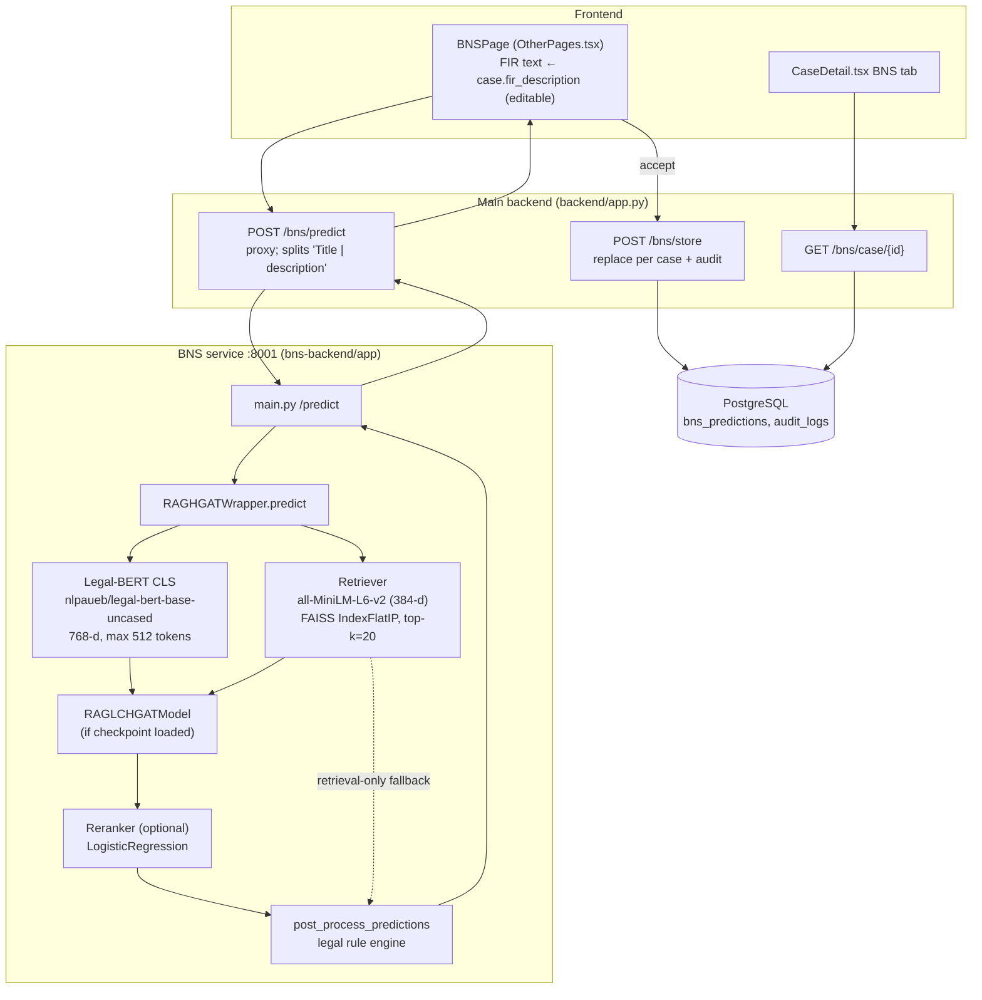
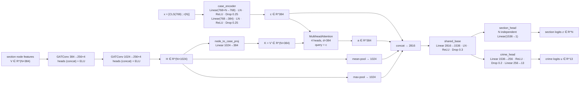
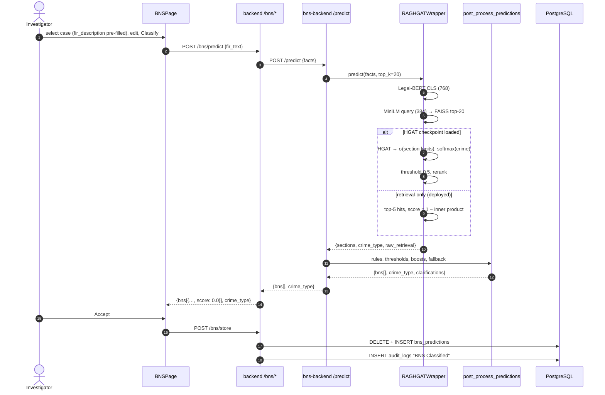

# Chapter 6 — BNS Classification Module

## 6.1 What it is and why it is needed

The module recommends Bharatiya Nyaya Sanhita (BNS, 2023) sections and a crime category for the narrative facts of an FIR. After the replacement of the Indian Penal Code on 1 July 2024, investigators must cite BNS section numbers. The module is decision support: its output is shown to the investigator, who accepts it before it is stored (`OtherPages.tsx::BNSPage.accept`).

**What it is not.** The module contains **no large-language-model component and no prompt engineering**. Classification uses a supervised neural network (Legal-BERT encoder + graph attention network over section nodes) with dense retrieval (FAISS) and a hand-written legal rule layer. Requested topics such as "prompt design" and "prompt security" therefore do not apply (Chapter 9, Section 9.9).

## 6.2 Folder structure

```
bns-backend/                              # separate FastAPI service ("BNS Generator API" v1.2)
├── app/
│   ├── main.py            # HTTP API: /health, /metrics, /predict, /predict_verbose, /retrieve; Prometheus metrics
│   ├── model_wrapper.py   # RAGHGATWrapper: Legal-BERT CLS, sentence retrieval (FAISS), HGAT inference, reranker, fallbacks
│   ├── hgat_model.py      # RAGLCHGATModel: case encoder, 2-layer GAT, cross-attention, section/crime heads
│   ├── postprocess.py     # legal rule engine: attribute extraction, cluster thresholds, boosts, pruning, fallback
│   └── bns.py             # BNS_SECTION_DETAILS: 1594-line section catalogue (title, description, punishment, keywords…)
├── Model_Data/
│   ├── faiss.index        # IndexFlatIP, 83 vectors × 384 dims
│   ├── section_embeddings.npy   # 83 × 384 float32 section embeddings (also GAT node features)
│   └── sections_meta.json # 83 sections: {"id", "text": "Title | description"}
├── scripts/
│   ├── build_faiss.py            # encode sections, L2-normalise, build IndexFlatIP
│   ├── build_cooccur_graph.py    # keyword-overlap section graph → cooccur_edge_index.pt
│   ├── persist_node_features.py  # notes on node-feature persistence
│   ├── train_reranker.py         # logistic-regression reranker on data/val.jsonl
│   ├── validate_rerank.py        # threshold/alpha grid search → tuning_results.json
│   └── auto_retrain.py           # wrapper to re-run reranker training
├── data/
│   ├── bns_synthetic_cases_10000.csv   # training corpus (Fact, Crime_Type, BNS_Sections, Section_Count)
│   ├── val.jsonl                       # EMPTY (0 lines)
│   └── *.csv                           # evaluation exports from the notebook
├── hgatm.ipynb            # training and evaluation notebook (21 code cells)
├── Images/                # evaluation figures exported by the notebook
├── runs/reranker_train/   # TensorBoard event files
├── tuning_results.json    # grid-search output: every F1 value is NaN
└── requirements.txt
backend/app.py             # proxy + persistence: POST /bns/predict, POST /bns/store, GET /bns/case/{id}
backend/models.py          # BNSPrediction (table bns_predictions)
audit-frontend/src/pages/OtherPages.tsx   # BNSPage
audit-frontend/src/pages/CaseDetail.tsx   # BNS tab (read-only view)
```

## 6.3 Deployment state (verified)

| Artefact expected by `model_wrapper.py` | Present in `Model_Data/`? | Effect when absent |
|---|---|---|
| `faiss.index` | yes | — |
| `section_embeddings.npy` | yes | — |
| `sections_meta.json` | yes (83 entries) | — |
| `best_rag_hgat_model.pth` | **no** (`*.pth` is git-ignored) | `self.model` is never loaded → **retrieval-only mode** |
| `cooccur_edge_index.pt` | no | a fully connected graph would be used |
| `reranker.pkl`, `reranker_config.json` | no | sort by model score |
| `crime_map.json` | no | crime type `"unknown"` (retrieval-only) or a numeric index string |

Further observations:
- **Section-count mismatch.** The training corpus uses **57** distinct sections (13 crime types). `sections_meta.json` lists **83** (the 57 plus 26 more). The wrapper sizes the network with `num_sections = len(sections_meta) = 83`, so its case-encoder input is $768+83$, whereas a checkpoint trained on 57 sections expects $768+57$. `load_state_dict` would fail, and the wrapper would fall back to retrieval-only mode even if the checkpoint were present.
- **Port.** `bns-backend/.env` sets `PORT=8000`, which collides with the main backend. The main backend's proxy calls `http://localhost:8001/predict`, and the frontend error message instructs `uvicorn app.main:app --port 8001`. The service was not running during this analysis.
- **Unlisted dependency.** `main.py` imports `prometheus_client`, which is installed in the service's venv but missing from `requirements.txt`.
- **Secrets hygiene.** `bns-backend/.env` is tracked in git, although it contains only non-secret configuration (`FRONTEND_ORIGIN`, `MODEL_DIR`, `PORT`, model names).

The architecture described in Sections 6.5–6.8 is what the code implements and what the training notebook trained. **The deployed service currently executes the retrieval-only path (Section 6.6.4) and the rule engine (Section 6.7).**

## 6.4 System architecture



## 6.5 Input processing

- **Main backend** (`app.py::bns_predict`): body `{"fir_text": str}` becomes `POST http://localhost:8001/predict {"facts": fir_text}`, with a 30 s timeout. Only `facts` is forwarded; `title`, `top_k`, `victim_age`, `victim_gender`, `num_offenders` and `weapon_used` are not sent, so the service uses its defaults (`top_k=20`, attributes inferred from text).
- **Service validation** (`main.py`): model not loaded → 503; `len(facts.strip()) < 5` → 400 "facts text too short".
- **Encoding** (`model_wrapper.predict`):
  1. Legal-BERT tokenisation with `truncation=True`, `padding="max_length"`, `max_length=512`. Narratives longer than 512 WordPiece tokens are truncated. The CLS vector $h_{CLS}\in\mathbb{R}^{768}$ is taken from the last hidden layer.
  2. Sentence embedding $q\in\mathbb{R}^{384}$ with `all-MiniLM-L6-v2` (which ends in a normalisation layer, so $\|q\|_2 = 1$; measured 1.0).

## 6.6 Classification pipeline

### 6.6.1 Dense retrieval (`RAGHGATWrapper.retrieve`)
Section vectors $e_j$ were L2-normalised when the index was built (`scripts/build_faiss.py`: `faiss.normalize_L2`, `IndexFlatIP`). FAISS returns the top-$k$ sections by inner product (equal to cosine similarity here):

$$\mathrm{sim}_j = q^\top e_j = \cos(q, e_j),\qquad \mathcal{H}_k = \operatorname{top\text{-}k}_j\ \mathrm{sim}_j .$$

The wrapper then converts each hit to a **score**

$$s^{RAG}_j = 1 - \mathrm{sim}_j\qquad\text{(code: }\texttt{"score": float(1.0 - dist)}\text{, comment "convert distance to similarity")}.$$

This conversion is correct for a *distance* index (`IndexFlatL2`), but the index is `IndexFlatIP`, whose returned value is already a similarity. The score is therefore a **dissimilarity**: the ranking order from FAISS is preserved, but every threshold applied later reads inverted values. The measured effect is shown in Section 6.6.5.

A second retrieval branch (`section_embeddings.npy` with explicit cosine similarity, `sims = e_norm @ q_norm`) is correct, but it is used only when `faiss.index` is absent.

### 6.6.2 RAG feature vector
Retrieval scores are scattered into a vector aligned with `sections_meta` order and scaled by 10:

$$r\in\mathbb{R}^{N},\qquad r_j = 10\cdot \max_{h\in\mathcal{H}_k,\ id(h)=j} s^{RAG}_h \ (0 \text{ if not retrieved}),\qquad x = [\,h_{CLS}\,;\,r\,]\in\mathbb{R}^{768+N}.$$

### 6.6.3 RAG-LC-HGAT network (`hgat_model.py::RAGLCHGATModel.infer_from_features`)



- **Graph.** Nodes are sections. Edges come from `cooccur_edge_index.pt` if present, built by `scripts/build_cooccur_graph.py`, which connects two sections sharing at least one catalogue keyword. Otherwise `_ensure_edge_index` builds a complete graph with $N^2$ directed edges including self-loops. Without `torch_geometric`, each GAT layer degrades to `Linear + ELU`.
- **Node features.** `section_embeddings.npy` (the same MiniLM vectors used for retrieval). These are case-independent, so $H$, the pooled vectors and the attention keys are identical for every query; only the query $c$ depends on the case.
- **Outputs.** Section probabilities $p_j=\sigma(z_j)$ (multi-label) and crime distribution $\pi=\operatorname{softmax}(u)$ (single-label).

### 6.6.4 Decision logic in the wrapper (`model_wrapper.predict`)
1. If no model is loaded, return the top 5 retrieval hits as `(section_id, s^{RAG}, text[:400])` with `crime_type="unknown"`. **This is the deployed path.**
2. Otherwise, candidate sections are those with $p_j \ge 0.5$.
3. If there is no candidate, return the top 5 retrieval hits and the crime label from `crime_map.json`.
4. Otherwise, rerank (Section 6.8.4). The crime label is $\arg\max_c \pi_c$, mapped through `crime_map.json` (else the index as a string).

### 6.6.5 Measured behaviour of the deployed path [measured]
For the facts *"Two unknown persons broke into the house at night and stole a laptop and a television."*:

| FAISS rank | Section | Title | cos (inner product) | wrapper score $1-\cos$ |
|---|---|---|---|---|
| 1 | 303(2) | Theft in dwelling house | 0.4127 | **0.5873** |
| 2 | 306 | Robbery | 0.3201 | 0.6799 |
| 3 | 319 | Cheating by personation using computer resource | 0.3186 | 0.6814 |
| 4 | 137(1) | Kidnapping from India or lawful guardianship | 0.3020 | 0.6980 |
| 5 | 311 | Dacoity | 0.2987 | 0.7013 |

The post-processor returned **only `306 Robbery`**, with `crime_type = "unknown"`. The best match, 303(2), was dropped because its inverted score 0.587 is below the 0.60 property threshold, while the four less-similar sections received *higher* scores. The output items contain no score field (Section 6.9).

## 6.7 Rule engine (`postprocess.py::post_process_predictions`)

### 6.7.1 Attribute extraction (`extract_basic_attrs`)
Regular expressions infer:
- **victim age:** `(\d{1,3})\s*(years?|yrs?)`, accepted if 0 < age < 120;
- **number of offenders:** a number word or digit followed by persons/people/men/women/accused/offenders/perpetrators;
- **weapon use:** knife, gun, pistol, weapon, iron rod, sword, machete, scissor, bat, gunshot, firearm, stabbing;
- **victim gender:** a female-word list takes precedence over a male-word list.

An explicit `weapon_used=true` is overridden to false if the facts contain "no injury" or "no weapon" phrases (metric `weapon_override_count`). Missing gender, age or offender count produce **clarification questions**, which the `/predict` endpoint does not return (only `/predict_verbose` does).

### 6.7.2 Offence clusters and thresholds
- **Clusters:** `CLUSTER_MAP` assigns sections to *property*, *violent*, *sexual*, *kidnapping* and *fraud* clusters (sections 318, 319 and 336 appear in both property and fraud; the last assignment wins in `SECTION_TO_CLUSTER`). Unlisted sections are *default*.
- **Thresholds:** default 0.60, violent 0.80, murder (100–102) 0.85, sexual 0.99 (used as 0.90 in the checks), kidnapping 0.70, fraud 0.60.
- **Other constants:** `RAG_HIT_MIN_SCORE = 0.55`, `CLUSTER_BOOST_ALPHA = 0.6`.

### 6.7.3 Candidate filtering (per raw section $j$ with score $s_j$ and retrieval score $\tilde r_j$)
A candidate is **dropped** when any of these hold:
1. $\tilde r_j < 0.55 \wedge s_j < 0.60 + 0.15$ (weak retrieval support and not confident);
2. the section has catalogue keywords, $\tilde r_j < 0.7$, and none of its keywords occurs in the facts;
3. **property/kidnapping disambiguation:** the facts contain property words and no kidnapping words, the section is in the kidnapping cluster, and $s_j<0.95 \wedge \tilde r_j < 0.9$;
4. **violent cluster:** a murder section with $s_j < 0.85$ or without violence words, a weapon, or "dead/died"; any other violent section with $s_j<0.80$;
5. **sexual cluster:** the section text requires a child and the victim age is unknown or ≥ 18; the text mentions woman/female and the gender is unknown or not female; or $s_j<0.90$ with no violence words;
6. **property** with $s_j < 0.60$; **kidnapping** with $s_j<0.70$;
7. a weapon-related section when the facts explicitly say no weapon.

**Keyword rules are inactive in the deployed configuration.** Rule 2 and the keyword bonus below read `keywords` from `sections_meta`. The deployed `sections_meta.json` entries have only `id` and `text`, so every keyword list is empty. `BNS_SECTION_DETAILS` (which has keywords) is consulted only when no `sections_meta` is supplied.

This also explains the measured example in Section 6.6.5:
- **303(2)** (inverted score 0.587) fails the property threshold of 0.60.
- **319** is assigned to the fraud cluster, and **311** falls in the default cluster. Both are damped ×0.4 by property priority and then pruned.
- **137(1)** is blocked by the property/kidnapping rule.
- Only **306** survives.

### 6.7.4 Cluster boosting
With $\bar s_{c}$ the mean score of the surviving candidates in cluster $c$ and $\bar s$ the global mean,

$$b_j = \operatorname{clip}\Bigl(1 + 0.6\cdot\frac{\bar s_{c(j)} - \bar s}{\bar s + 10^{-8}},\ 0.6,\ 1.6\Bigr),\qquad s'_j = s_j\, b_j .$$

Then:
- **Property-priority damping:** if the facts indicate property and $c(j)\ne$ property, $s'_j<0.95$ and $\tilde r_j<0.9$, set $s'_j \leftarrow 0.4\,s'_j$.
- **Keyword bonus:** $s'_j \leftarrow \min(0.9999,\ s'_j + 0.03)$ if any section keyword appears in the facts.
- **Clip:** $s'_j \in [0, 0.9999]$.

### 6.7.5 Final pruning, de-duplication, fallback
Per-cluster thresholds are applied again to $s'_j$. Sections with $\tilde r_j < 0.55$, no keyword match and $s'_j<0.95$ are removed. Survivors are sorted by $s'_j$ and de-duplicated by `section_id`. If nothing survives:
- the top 5 property candidates are returned, if any exist;
- otherwise (no candidate passed the first filter) the **top 10 retrieval hits** are returned unfiltered.

Each output item is `{section_id, name, meaning}`. The name comes from `sections_meta` (or `BNS_SECTION_DETAILS.title`), and the meaning is the section text truncated to 400 characters.

### 6.7.6 Rule-engine metrics
Counters such as `murder_dropped_by_threshold`, `sexual_child_dropped` and `kidnap_blocked_by_property` are accumulated in memory and exposed through `GET /metrics` as Prometheus counters prefixed `bns_pp_`.

## 6.8 Training (notebook `hgatm.ipynb`) [code + reported]

### 6.8.1 Data
`data/bns_synthetic_cases_10000.csv` contains **10 000 synthetic, template-generated cases**: 13 crime types, 57 distinct sections, 2.55 sections per case on average (range 1–5).

| Crime type | Cases | Crime type | Cases |
|---|---|---|---|
| Theft or Robbery | 1850 | Dowry Harassment | 550 |
| Fraud or Cheating | 1650 | Cyber Crime | 450 |
| Sexual Offense | 1400 | Domestic Violence | 450 |
| Assault | 1100 | Extortion | 400 |
| Murder | 750 | Narcotics | 150 |
| Kidnapping | 650 | Others | 50 |
| Attempt to Murder | 550 | | |

Labels are encoded with `MultiLabelBinarizer` (sections) and `LabelEncoder` (crime type). The split is stratified by crime type: 70 % train, then the remaining 30 % halved into 15 % validation and 15 % test (1500 cases), with `random_state=42`.

### 6.8.2 Objective
- **Section head:** Asymmetric Loss (ASL) with $\gamma^- = 2$, $\gamma^+ = 2$, clip $m=0.05$. With $p=\sigma(z)$ and the shifted probability $p_m=\max(p-m,0)$:
$$\mathcal{L}_{ASL} = -\sum_j \Bigl[\,y_j\,(1-p_j)^{\gamma^+}\log p_j + (1-y_j)\,p_{m,j}^{\gamma^-}\log(1-p_{m,j})\Bigr].$$
- **Crime head:** cross-entropy $\mathcal{L}_{CE} = -\log \pi_{y}$.
- **Total:** $\mathcal{L} = 0.85\,\mathcal{L}_{ASL} + 0.15\,\mathcal{L}_{CE}$.

A focal loss class ($\alpha=0.25,\ \gamma=2$) is also defined in the notebook but is not the section criterion in the final training cell.

### 6.8.3 Optimisation
AdamW with weight decay; the final cell's comment records the learning rate "REDUCED from 0.001" to $10^{-4}$. Training uses `ReduceLROnPlateau(mode='max', factor=0.5, patience=7, min_lr=1e-6)` on validation Hamming accuracy, early stopping with patience 15 (δ = 1e-4), gradient-norm clipping at 1.0, gradient accumulation over 2 steps, and at most 100 epochs. Training stopped after 63 epochs; the best checkpoint came from epoch 50 and was saved as `best_rag_hgat_model.pth` (not committed).

### 6.8.4 Reranker (`_apply_reranker`, `scripts/train_reranker.py`)
Per candidate, the feature vector is $\phi = [\overline{h_{CLS}},\ \bar r,\ p_j,\ \tilde r_j,\ \mathbb{1}[\text{cluster}]]$ (the means are scalars). A logistic regression gives $\hat y_j = \sigma(w^\top\phi + b)$, and the combined score is

$$s^{comb}_j = \alpha\,\hat y_j + (1-\alpha)\,p_j,\qquad \alpha=0.7 .$$

**Status: not trained.** `data/val.jsonl` is empty, and `tuning_results.json` contains NaN F1 for every threshold/α pair. Without `reranker.pkl`, candidates are sorted by $(p_j,\ \tilde r_j)$.

### 6.8.5 Reported evaluation (test split, 1500 synthetic cases) [reported]
Computed by the notebook (cell 15 output "TEST SET EVALUATION", best model from epoch 50) and exported to `data/model_performance_summary.csv`:

| Metric | Sections (multi-label) | Crime type |
|---|---|---|
| F1-micro | 0.9871 | 0.9927 |
| F1-macro | 0.9840 | 0.9954 |
| F1-weighted | 0.9880 | 0.9927 |
| Precision | 0.9835 | 0.9927 |
| Recall | 0.9937 | 0.9927 |
| Hamming accuracy / accuracy | 0.9988 | 0.9927 |
| Exact match (subset accuracy) | 0.9527 | — |

`data/section_classification_summary.csv` additionally reports a mean per-section ROC-AUC of 0.9997 and PR-AUC of 0.9873.

**Caveats that must accompany these figures.**
1. The test set is drawn from the same template-generated distribution as the training data. Near-perfect scores therefore measure fit to the generator, not generalisation to real FIRs.
2. The deployed service does not run this model (Section 6.3).
3. In `data/ablation_study_results.csv` and the notebook's ablation cell, **only the first row (the full model) is measured**. The four "w/o" rows are literal values under the comment "Define ablation models (replace with your actual results)". **No ablation study was performed; those rows must not be reported as results.**

## 6.9 APIs

### 6.9.1 BNS service (`bns-backend/app/main.py`)

| Method | Route | Request | Response | Errors |
|---|---|---|---|---|
| GET | `/health` | — | `{"status": "ok"\|"error", "model_loaded": bool}`. `model_loaded` means the *wrapper* initialised, not that the HGAT checkpoint loaded. | — |
| GET | `/metrics` | — | Prometheus text: `bns_predict_requests_total`, `bns_predict_failures_total`, `bns_predict_latency_seconds`, `bns_postprocess_latency_seconds`, `bns_pp_*` | — |
| POST | `/predict` | `PredictRequest` | `{"bns": [{"section_id", "name", "meaning"}], "crime_type"}` | 503 wrapper missing; 400 facts < 5 characters; 500 inference exception |
| POST | `/predict_verbose` | `PredictRequest` | `{"predicted_sections": [{"section_id", "score", "evidence"}], "crime_type", "rag_retrieval", "clarifications"}` | same |
| POST | `/retrieve` | `PredictRequest` | `{"hits": [{"section_id", "score", "text"}]}` | 503 / 500 |

`PredictRequest`: `facts` (required), `title`, `top_k` (default 20), `victim_age`, `victim_gender`, `num_offenders`, `weapon_used`.

`/predict_verbose` expects `post_process_predictions` to return `predicted_sections`, but that function returns `bns`. When post-processing succeeds, `predicted_sections` is therefore always an empty list; populated sections appear only on its exception fallback path.

CORS allows `FRONTEND_ORIGIN` (default `http://localhost:5173`) and `http://localhost:8080`. The service has no authentication.

### 6.9.2 Main backend (`backend/app.py`)

| Method | Route | Auth | Behaviour |
|---|---|---|---|
| POST | `/bns/predict` | **none** | Body `{"fir_text"}`. Proxies to `:8001/predict`. Each `meaning` is split on `" \| "` into `name` and `meaning`, and `score` is set to `sec.get("score", 0.0)`, which is **always 0.0** because the service's items have no score. Returns `{"bns": [{section_id, name, meaning, score}], "crime_type"}`. Service unreachable or HTTP error → 502. |
| POST | `/bns/store` | JWT + `check_case_access` | Body `{case_id, crime_type, sections, fir_text}`. Deletes the case's previous predictions and inserts one row in `bns_predictions`, then writes the audit entry "BNS Classified" `{crime_type, sections_count}`. DB error → 500. |
| GET | `/bns/case/{case_id}` | JWT + `check_case_access` | Returns all predictions for the case, newest first. |
| GET | `/ai/bns/case/{case_id}` | JWT + case check | Stub: always `{"data": []}`. |

### 6.9.3 Response fields shown to users

| Field | Source | Meaning |
|---|---|---|
| `section_id` | `sections_meta.id` | BNS section, e.g. `303(2)` |
| `name` | part before `" \| "` in the section text | Section title |
| `meaning` | part after `" \| "` (≤ 400 characters in total) | Statutory description |
| `score` | proxy default | always 0.0 (no confidence is propagated) |
| `crime_type` | `crime_map.json` or `"unknown"` | Crime category |

## 6.10 Database

Table `bns_predictions` (`models.py::BNSPrediction`, `schema.sql` §8):

| Column | Type | Notes |
|---|---|---|
| `id` | UUID PK | |
| `case_id` | UUID NOT NULL | FK → `cases.id` ON DELETE CASCADE; index `idx_bns_predictions_case_id` |
| `crime_type` | TEXT NOT NULL | |
| `sections` | JSONB NOT NULL | array of `{section_id, name, meaning, score}` as accepted |
| `fir_text` | TEXT | the narrative that was classified |
| `created_at` | TIMESTAMPTZ | |

Storing replaces all rows of the case, so exactly one prediction is kept per case. The dashboard statistic `bns_classified` counts rows (`app.py`, stats endpoint).

**Caching:** none at any layer. Every `/predict` call re-encodes and re-retrieves.

## 6.11 Frontend

- **`BNSPage`** (`OtherPages.tsx`): search and select a case, which pre-fills `fir_description`; edit the text; *Classify* (`api.predictBNS`); view the crime type and the section list; *Accept* (`api.storeBNS`). On failure it shows an instruction to start the BNS server on port 8001.
- The page also shows three **hard-coded** "evidence insights" strings (`useState([...])`: "Weapon detected in scene — supports violent offence", …). They are constant UI text, not derived from evidence or models.
- **`CaseDetail.tsx`**: the BNS tab shows the most recent stored prediction, and the case summary counts its sections.

## 6.12 Sequence



## 6.13 BNS algorithms and mathematics

### 6.13.1 Similarity and retrieval
- **Cosine similarity** of unit vectors: $\cos(q,e)=q^\top e$.
- **Exact inner-product search** over $N$ vectors of dimension $d$ (`IndexFlatIP`): $O(Nd)$ per query ($83\times384$ multiply-adds) plus $O(N\log k)$ selection.
- **Correct score for this index:** $s = \cos(q,e)$, not $1-\cos$.

### 6.13.2 Graph attention (GATConv, Veličković et al.)
For node $i$ with neighbours $\mathcal{N}(i)$ and head $h$:

$$e^{h}_{ij} = \mathrm{LeakyReLU}\bigl(a_h^\top [W_h v_i \,\|\, W_h v_j]\bigr),\qquad \alpha^h_{ij} = \frac{\exp(e^h_{ij})}{\sum_{k\in\mathcal{N}(i)}\exp(e^h_{ik})},$$

$$v'_i = \big\Vert_{h=1}^{4}\ \mathrm{ELU}\Bigl(\sum_{j\in\mathcal{N}(i)} \alpha^h_{ij} W_h v_j\Bigr)\in\mathbb{R}^{4\cdot256}.$$

Attention dropout is 0.1. The cost per layer is $O(|E|\cdot d)$. On the fallback complete graph $|E|=N^2$ (6889 edges for $N=83$).

### 6.13.3 Cross-attention (scaled dot-product, 4 heads)
Query $c$, keys and values $K=V=\mathrm{proj}(H)$:

$$\mathrm{head}_m = \operatorname{softmax}\Bigl(\frac{(cW^Q_m)(KW^K_m)^\top}{\sqrt{d_k}}\Bigr)VW^V_m,\qquad d_k = 384/4 = 96,$$

$$a = [\mathrm{head}_1;\dots;\mathrm{head}_4]W^O.$$

### 6.13.4 Output layers
- **Multi-label sections:** $p_j = \sigma(z_j) = 1/(1+e^{-z_j})$, and section $j$ is predicted iff $p_j\ge 0.5$.
- **Single-label crime:** $\pi_c = e^{u_c}/\sum_{c'} e^{u_{c'}}$, with $\hat c = \arg\max_c \pi_c$.

### 6.13.5 Ranking
Without a reranker, candidates are sorted lexicographically by $(p_j, \tilde r_j)$ descending. With one, they are sorted by $s^{comb}_j$ (Section 6.8.4). The rule engine re-sorts by boosted score $s'_j$ (Section 6.7.4).

### 6.13.6 Confidence
- **Internally:** $p_j$ (model), $s^{comb}_j$ (reranked) and $s'_j$ (boosted, clipped to $[0,0.9999]$).
- **Externally:** none. `/predict` drops scores and the proxy substitutes 0.0. No calibration (temperature scaling, isotonic regression) is implemented.

### 6.13.7 Evaluation metrics (as computed in the notebook)
For $n$ cases and $L$ labels:
- **Hamming accuracy:** $1-\frac{1}{nL}\sum_{i,j}[\hat y_{ij}\ne y_{ij}]$.
- **Exact match:** $\frac1n\sum_i[\hat y_i = y_i]$.
- **Micro-F1:** $\frac{2\sum TP}{2\sum TP + \sum FP + \sum FN}$ (pooled over labels).
- **Macro-F1:** $\frac1L\sum_j F1_j$.
- **Weighted-F1:** $\sum_j \frac{\mathrm{support}_j}{\sum \mathrm{support}} F1_j$.
- **ROC-AUC / PR-AUC:** per label, averaged.

### 6.13.8 Complexity of one prediction
Legal-BERT forward pass: $O(T^2 d)$ with $T = 512$ tokens and $d = 768$ (dominant). Then MiniLM encoding, $O(Nd)$ search, GAT $O(|E|d)$, attention $O(Nd)$, and heads $O(N\cdot1536)$. The rule engine is $O(k\cdot|\text{keywords}|\cdot|\text{facts}|)$ string search.

## 6.14 Advantages
1. A hybrid design that combines a learned encoder, retrieval grounding and explicit legal preconditions (age, gender and weapon checks) that a pure classifier would not guarantee.
2. Multiple fallbacks: the service returns *some* statutory candidates even with no trained model.
3. Operational telemetry via Prometheus.
4. Human-in-the-loop acceptance before persistence, with an audit trail.

## 6.15 Limitations (verified)
1. **The deployed service runs retrieval-only.** The checkpoint is absent, and a 57-section checkpoint would be incompatible with the 83-section metadata.
2. **Score inversion** ($1-\cos$ on an inner-product index) makes the rule engine prefer less similar sections. It was demonstrated to drop the correct "theft in dwelling house" section.
3. **No confidence reaches the user** (scores dropped, proxy sets 0.0).
4. **No authentication** on `/bns/predict` (main backend) or on the BNS service itself.
5. **The training data is synthetic.** Reported metrics do not measure real-world performance, and the ablation table is placeholder data.
6. Inputs longer than 512 tokens are truncated. The model and retriever are English (Legal-BERT, MiniLM), so Hindi or Kannada FIR text is out of domain. OCR translation (Chapter 2) can bridge this manually.
7. Clarification questions are generated but never shown.
8. The OCR → BNS hand-off is manual.

## 6.16 Future improvements
1. Fix the retrieval score ($s=\cos$) and re-tune `RAG_HIT_MIN_SCORE` and the cluster thresholds on a labelled validation set.
2. Pin `sections_meta` to the trained label space (57 sections), or retrain on 83. Commit the checkpoint through a model registry, and verify at startup that it loaded.
3. Return calibrated per-section probabilities through `/predict` and the proxy, and display them.
4. Build a real, de-identified FIR evaluation set, run a genuine ablation (no RAG, no graph, no section embeddings), and report confidence intervals.
5. Add authentication and rate limiting to `/bns/predict`, and to the service (bind it to localhost or use mTLS).
6. Automatic OCR → BNS pipeline: pass OCR text (translated to English when needed) with provenance, and hash both on-chain.
7. Multilingual encoders (e.g. IndicBERT or MuRIL) for native-language FIRs.
