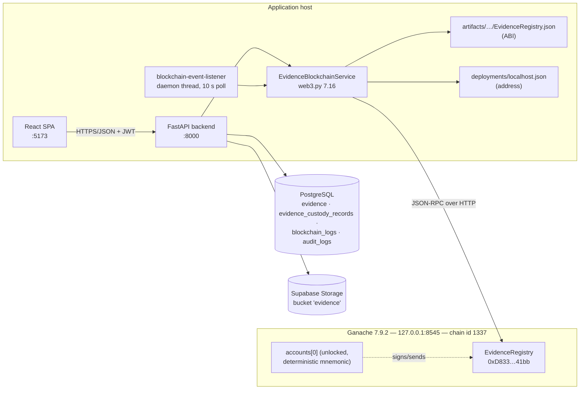
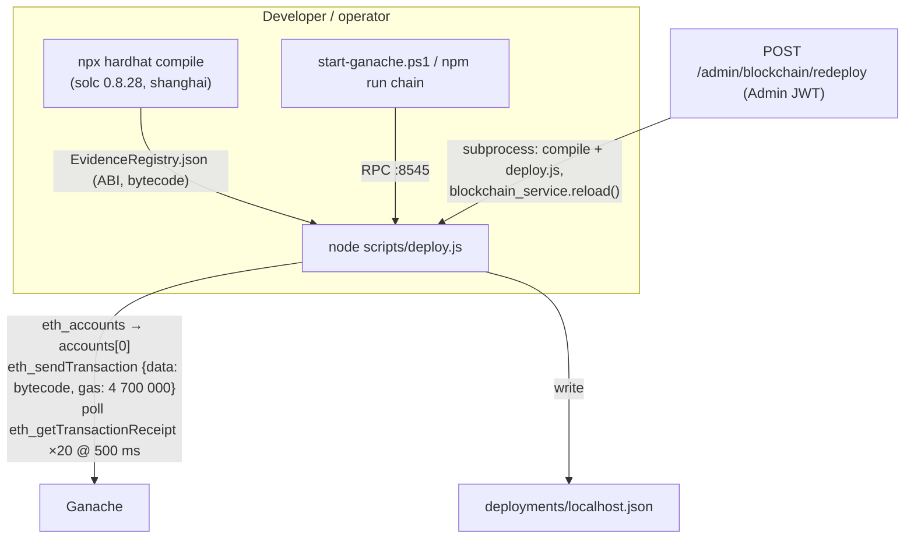
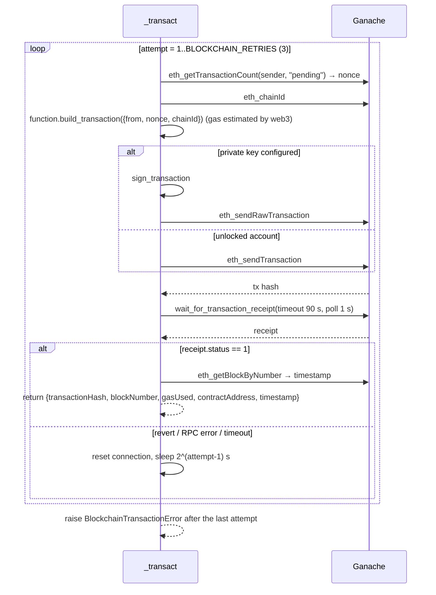
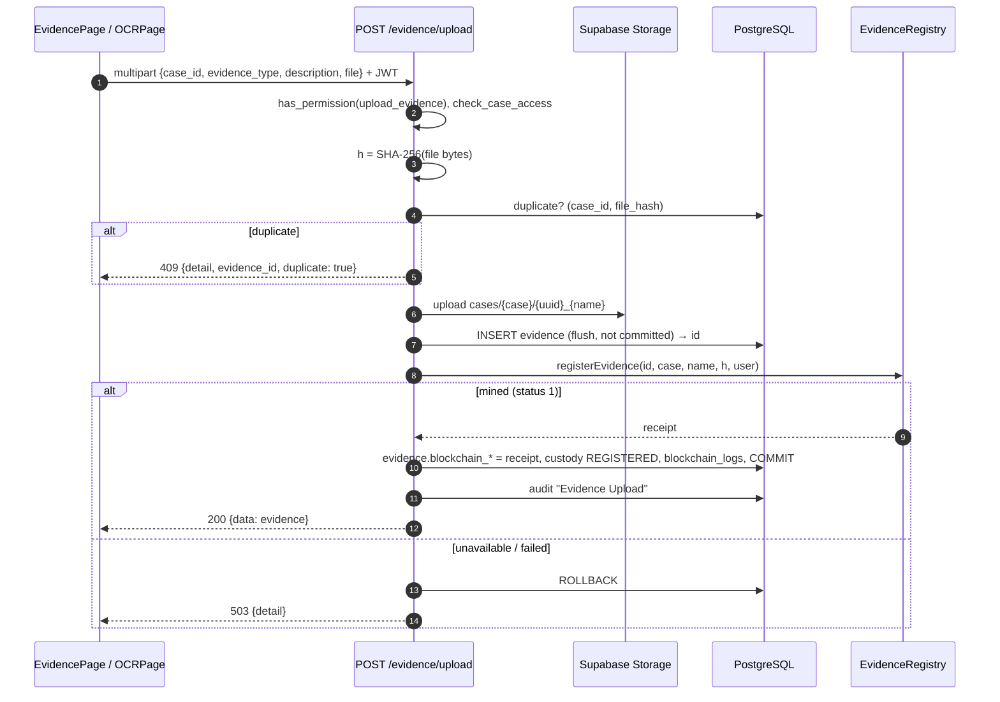

# Chapter 7 — Blockchain Evidence Integrity Module

## 7.1 What it is and why it is needed

Every uploaded evidence file is hashed with SHA-256, and the digest is written to an Ethereum smart contract (`EvidenceRegistry`) before the upload is committed. Verification re-hashes the stored file and asks the contract to compare. Because the reference digest lives in a replicated, append-only ledger rather than in the application database, altering a file *and* its database hash is not enough to hide tampering. The ledger copy also exposes database tampering (Section 7.7.3). The contract additionally keeps a chain-of-custody log per evidence item.

## 7.2 Folder structure

```
blockchain/                                  # Hardhat 3 project (ES modules)
├── contracts/EvidenceRegistry.sol           # Solidity 0.8.28 contract
├── hardhat.config.ts                        # solc 0.8.28, evmVersion "shanghai", network localhost:8545
├── scripts/deploy.js                        # raw JSON-RPC deployment; writes deployments/localhost.json
├── deployments/localhost.json               # {address, transactionHash, chainId: 1337, deployedAt}
├── artifacts/…/EvidenceRegistry.json        # ABI + bytecode (git-ignored; produced by `npx hardhat compile`)
├── start-ganache.ps1                        # persistent Ganache launcher (--database.dbPath ganache-data)
├── package.json                             # devDeps hardhat ^3.14, typescript; script "chain"
└── .gitignore                               # artifacts, cache, ganache-data, .env
backend/
├── services/blockchain_service.py           # EvidenceBlockchainService (Web3.py gateway)
├── app.py                                   # upload, verify, custody, /blockchain/* routes, event listener
├── models.py                                # Evidence (receipt columns), EvidenceCustodyRecord, BlockchainLog
├── migrate_blockchain.py                    # columns and tables migration
└── backfill_blockchain_registration.py      # registers legacy evidence (dry-run by default)
docs/BLOCKCHAIN_INTEGRATION.md               # operator documentation
audit-frontend/src/pages/CaseDetail.tsx      # Verify Integrity, Blockchain Details, custody timeline
audit-frontend/src/pages/OtherPages.tsx      # EvidencePage Verify Hash
audit-frontend/src/pages/BlockchainDashboard.tsx
```

## 7.3 Architecture and deployment





**Deployment facts [code, measured]**
- `deploy.js` uses raw JSON-RPC (`fetch`) rather than ethers or viem. It deploys from `eth_accounts()[0]` with a fixed gas limit of 4 700 000 and records the address, transaction hash, chain ID and timestamp.
- The currently deployed registry is `0xD833215cBcc3f914bD1C9ece3EE7BF8B14f841bb` on chain 1337 (Ganache 7.9.2, started with `--wallet.deterministic`).
- **Persistence.** The running node was started **without** `--database.dbPath` (in-memory). A restart erases all state. `blockchain/start-ganache.ps1` (and `npm run chain`) adds `--database.dbPath blockchain/ganache-data`. Migrating requires one restart, one deployment and a re-run of the backfill (script header).
- **Automatic redeployment is disabled** (`BLOCKCHAIN_AUTO_REDEPLOY=false`). If no contract code exists at the configured address, the gateway raises `BlockchainUnavailable` with an explanation instead of silently deploying an empty registry.

## 7.4 Smart contract (`EvidenceRegistry.sol`)

### 7.4.1 State

```solidity
struct Evidence { string evidenceId; string caseId; string fileName; string sha256Hash;
                  string uploadedBy; uint256 uploadTimestamp; bool exists; }
struct CustodyRecord { string officerId; string action; uint256 timestamp; }
mapping(string => Evidence)        private _evidences;
mapping(string => CustodyRecord[]) private _custodyHistory;
```

Only digests and metadata are stored; files are never stored on-chain. The key is the application's evidence UUID string.

### 7.4.2 Functions

| Function | Mutability | Preconditions (`require`) | Effects | Events |
|---|---|---|---|---|
| `registerEvidence(evidenceId, caseId, fileName, sha256Hash, uploadedBy)` | state-changing | every string non-empty; ID not already registered ("Evidence ID already registered") | stores `Evidence` with `uploadTimestamp = block.timestamp`, `exists = true`; appends custody `REGISTERED` | `EvidenceRegistered`, `CustodyTransferred("REGISTERED")` |
| `verifyEvidence(evidenceId, sha256Hash) returns (bool isMatch)` | state-changing (emits an event) | evidence exists; hash non-empty | $\text{isMatch} = [\,\mathrm{keccak256}(stored) = \mathrm{keccak256}(given)\,]$ | `EvidenceVerified` |
| `getEvidence(evidenceId) returns (Evidence)` | `view` | evidence exists | — | — |
| `addCustodyRecord(evidenceId, officerId, action)` | state-changing | evidence exists; officer and action non-empty; action ∈ {REGISTERED, VERIFIED, TRANSFERRED} (compared via keccak256) | appends a `CustodyRecord` | `CustodyTransferred` |
| `getCustodyHistory(evidenceId) returns (CustodyRecord[])` | `view` | evidence exists | — | — |

- **Solidity ≥ 0.8** gives checked arithmetic; no arithmetic is performed anyway.
- **String equality.** Solidity cannot compare strings directly, so the contract hashes both strings with keccak256 and compares the 32-byte digests.
- **Access control: none.** There is no owner, role or `msg.sender` check. Any account that can reach the RPC endpoint can register evidence, add custody records, or emit `EvidenceVerified` with `isMatch = true` by passing the publicly readable stored hash. This was confirmed at runtime on an isolated chain (Chapter 9, Section 9.5).

### 7.4.3 Events

| Event | Parameters | Indexed |
|---|---|---|
| `EvidenceRegistered` | `evidenceId`, `caseId`, `sha256Hash`, `uploadedBy`, `timestamp` | `evidenceId` (string) |
| `EvidenceVerified` | `evidenceId`, `sha256Hash`, `isMatch`, `timestamp` | `evidenceId` |
| `CustodyTransferred` | `evidenceId`, `officerId`, `action`, `timestamp` | `evidenceId` |

An indexed dynamic type is stored as $\mathrm{keccak256}(\text{value})$ in the log topic, not as the value. Decoded logs therefore return a 32-byte hash for `evidenceId`, not the UUID string (see 7.9).

## 7.5 Web3 gateway (`blockchain_service.py::EvidenceBlockchainService`)

### 7.5.1 Configuration

| Variable | Default | Use |
|---|---|---|
| `ETHEREUM_RPC_URL` | `http://127.0.0.1:8545` | JSON-RPC endpoint |
| `EVIDENCE_REGISTRY_ADDRESS` | — | overrides the deployment file |
| `EVIDENCE_REGISTRY_ARTIFACT` / `EVIDENCE_REGISTRY_DEPLOYMENT` | `blockchain/artifacts/…json` / `blockchain/deployments/localhost.json` | ABI / address |
| `ETHEREUM_PRIVATE_KEY` | — | sign locally (`send_raw_transaction`) |
| `ETHEREUM_SENDER_ADDRESS` | — | unlocked sender (`send_transaction`) |
| `BLOCKCHAIN_TX_TIMEOUT_SECONDS` | 90 | receipt wait |
| `BLOCKCHAIN_RETRIES` | 3 | transaction attempts |
| `BLOCKCHAIN_AUTO_REDEPLOY` | false | opt-in auto-deploy when the contract is missing |
| `BLOCKCHAIN_EVENT_POLL_SECONDS` (app) | 10 | listener interval |

### 7.5.2 Connection (`_connect`, `_ready`, `is_rpc_alive`)
1. A TCP liveness probe to the RPC host and port with a 1.5 s timeout avoids long HTTP hangs when the node is down.
2. `Web3(HTTPProvider(url, request_kwargs={"timeout": 15}))` followed by `is_connected()`.
3. The ABI is loaded from the Hardhat artifact.
4. The address is resolved in this order: runtime reload value, then `EVIDENCE_REGISTRY_ADDRESS`, then the deployment JSON. It is converted to a checksum address.
5. `eth_getCode(address)` must be non-empty, otherwise `BlockchainUnavailable` (auto-redeploy only if opted in).
6. The connected Web3 instance and contract are cached under an `RLock`, and reconnection happens lazily when needed.

### 7.5.3 Wallet (`_sender`)
The private key (local signing) takes precedence, then `ETHEREUM_SENDER_ADDRESS`, then `eth_accounts[0]` (a node-managed, unlocked account). The deployment in use relies on Ganache's unlocked deterministic account `0x90F8…c9C1`, whose private key is public knowledge.

### 7.5.4 Transaction life-cycle (`_transact`)



- **Confirmation depth** is one block. Ganache mines instantly and there are no reorganisations, so a single confirmation is final.
- **Returned fields:** `transactionHash` (hex, without the `0x` prefix under web3.py 7's `HexBytes.hex()`), `blockNumber`, `gasUsed`, `contractAddress` (`receipt.to`), and `timestamp` (block time, UTC).

### 7.5.5 Service operations

| Method | On-chain calls | Returns |
|---|---|---|
| `register_evidence(id, case, name, sha256, officer)` | `getEvidence` probe (reject if it exists) → `registerEvidence` tx | receipt dict |
| `verify_evidence(id, sha256, officer)` | `getEvidence` → `verifyEvidence` tx → decode `EvidenceVerified.isMatch` from the receipt (must exist and agree with `stored == sha256`) → `addCustodyRecord(…, "VERIFIED")` tx | `(isMatch, receipt + custodyTransaction + onChainHash + chainIsMatch)` |
| `transfer_custody(id, officer)` | `addCustodyRecord(…, "TRANSFERRED")` tx | receipt |
| `custody_history(id)` | `getCustodyHistory` view | `[{officerId, action, timestamp}]` (empty if not registered) |
| `get_registration(id)` | `getEvidence` view | record or `None` |
| `find_registration_receipt(id)` | `EvidenceRegistered` logs filtered by the indexed ID, plus the receipt and block | receipt dict (used by the backfill) |
| `status()` | liveness, chain ID, latest block, sender | `{connected, chainId, contractAddress, latestBlock, sender}` or `{connected: false, error}` |
| `recent_blocks(limit=8)` | `eth_getBlockByNumber` | block summaries |
| `events_since(from_block)` | `get_logs` for the three events | decoded events sorted by (block, tx) |

## 7.6 Evidence registration (`app.py::upload_evidence`)



Stored on the evidence row:

| Column | Source |
|---|---|
| `file_hash` | SHA-256 hex |
| `blockchain_tx_hash` | receipt (UNIQUE) |
| `blockchain_block_number` | receipt |
| `blockchain_contract_address` | receipt.to |
| `blockchain_gas_used` | receipt |
| `blockchain_registered_at` | block timestamp |

Registration is **synchronous and all-or-nothing** for the database: an evidence row never exists without a mined registration. Two gaps remain:
- the storage object is not deleted on rollback, which leaves an orphaned file;
- a database commit failure *after* mining leaves an on-chain registration without a row.

**Legacy evidence.** `backfill_blockchain_registration.py` registers items that have no valid registration on the current contract (Chapter 10). At commit `b7b478c` all 32 evidence items are registered.

## 7.7 Verification and tamper detection (`app.py::verify_evidence_hash`)

### 7.7.1 Algorithm
1. Authenticate and check case access.
2. `compute_evidence_file_hash(file_url)`: stream the stored object (or read the local file) and compute SHA-256.
   - The file is missing (HTTP 404, or Supabase's 400 `not_found`) → status **Missing**, audit "Evidence File Missing", **HTTP 404**.
   - Storage is unreachable → HTTP 502 and the status is unchanged (an outage is not tampering).
3. `get_registration(id)`. If there is none → status **Unregistered**, audit "Evidence Not Registered On-Chain", **HTTP 409**.
4. `verify_evidence(id, h_file)`. The contract compares the file hash with the registered hash, and the verdict is the emitted `isMatch`. A `VERIFIED` custody record is appended.
5. Status becomes **Verified** if `isMatch`, else **Tampered**. The endpoint writes a custody row, a `blockchain_logs` row (with calculated, blockchain and database hashes) and the audit entry "Hash Verified" or "Tamper Detected".
6. **Database-integrity cross-check.** If `evidence.file_hash ≠ onChainHash`, the response sets `databaseMatchesBlockchain: false`, includes a warning, and the audit log receives "Database Hash Mismatch". The blockchain hash is authoritative.

### 7.7.2 Response (200)
```json
{"success": true, "data": {
  "isVerified": true, "verified": true, "status": "Verified",
  "storedHash": "<db>", "stored_hash": "<db>",
  "calculatedHash": "<file>", "computed_hash": "<file>",
  "databaseHash": "<db>", "blockchainHash": "<chain>",
  "fileMatchesBlockchain": true, "databaseMatchesBlockchain": true,
  "verificationSource": "blockchain", "warnings": [],
  "transactionHash": "<verifyEvidence tx>", "blockNumber": 64,
  "custodyHistory": [{"officerId": "…", "officer_id": "…", "action": "REGISTERED", "timestamp": "…"}, "…"]
}}
```

Duplicate key names (camelCase and snake_case) are kept for backward compatibility with the frontend.

### 7.7.3 Tamper matrix (verified end-to-end, 17/17 checks passed)

| Scenario | Chain result | HTTP / status | Audit action | Frontend |
|---|---|---|---|---|
| Untouched file | `EvidenceVerified(isMatch=true)` + custody VERIFIED | 200 Verified | Hash Verified | "✓ Integrity verified on-chain", green |
| File bytes modified | `isMatch=false` + custody | 200 Tampered | Tamper Detected | "⚠ Hash mismatch — tampering detected", red |
| File contents replaced | `isMatch=false` | 200 Tampered | Tamper Detected | red |
| File deleted or renamed in storage | no transaction | 404 Missing | Evidence File Missing | "Evidence file is missing from storage", red |
| `evidence.file_hash` edited in the DB | `isMatch=true` (file matches chain) | 200 Verified + `databaseMatchesBlockchain:false` | Hash Verified + Database Hash Mismatch | "✓ … · ⚠ Database hash differs from the blockchain record" |
| `evidence.file_url` pointed at another file | `isMatch=false` | 200 Tampered | Tamper Detected | red |
| Evidence never registered | none | 409 Unregistered | Evidence Not Registered On-Chain | amber "Not registered on the blockchain" |
| Metadata only (description, type, display name) | `isMatch=true` | 200 Verified | Hash Verified | green (metadata is not covered by the hash) |
| `POST /blockchain/verify` with the correct hash for a tampered item | event `isMatch=true` | 200, **status unchanged** (Tampered) | none | — |

## 7.8 Chain of custody

| Record | Source |
|---|---|
| On-chain `CustodyRecord[]` per evidence: `REGISTERED` on registration, `VERIFIED` on every server-side verification, `TRANSFERRED` via `POST /evidence/{id}/custody/transfer` (officer ID is free text) | contract |
| Mirrored in `evidence_custody_records` (unique `transaction_hash`), read via `GET /evidence/{id}/blockchain` or `GET /blockchain/history/{id}` | `app.py` |
| Rendered as the "Chain of Custody Timeline" | `CaseDetail.tsx` |

## 7.9 Event handling (`app.py::synchronize_blockchain_events`)

- **Scheduling.** A daemon thread started at application startup polls `events_since(cursor)` every 10 s. The cursor lives in memory, initialised to `latestBlock − 1` at start-up, so events emitted while the backend was down are **not** processed.
- **Mapping.** Each event is looked up by `evidence.blockchain_tx_hash == event.txHash`, else by parsing `evidenceId` as a UUID. Because `evidenceId` is an *indexed string*, the decoded value is its keccak256 hash, so UUID parsing always fails. Events therefore map only when their transaction is the *registration* transaction.
- **Effects.**
  - A `blockchain_logs` row is inserted if none exists for (tx hash, event name). Unmapped events produce rows with `evidence_id = NULL`; 26 such rows were observed.
  - For mapped `EvidenceVerified` events, `evidence.status` is set from `isMatch`.
  - For mapped `CustodyTransferred` events, a custody row is inserted.

This listener trusts `isMatch` from any caller of the open contract. The decoding defect above currently prevents that from being exploitable (Chapter 9).

## 7.10 Endpoints

| Method | Route | Auth | Purpose / notes |
|---|---|---|---|
| POST | `/evidence/upload` | JWT, `upload_evidence`, case | Hash, store, register, persist (7.6) |
| POST | `/evidence/{id}/verify` | JWT, case | Server-side verification (7.7) |
| GET | `/evidence/{id}/blockchain` | JWT, case | `{status, evidence.blockchain receipt fields, custodyHistory}`; 503 if the chain is unavailable |
| POST | `/evidence/{id}/custody/transfer` | JWT, case | Body `{officer_id}`. `TRANSFERRED` tx, custody row, `blockchain_logs`, audit "Evidence Custody Transferred"; 422 empty officer; 503 chain |
| GET | `/blockchain/status` | **none** | `{network: "Ganache"\|"Unavailable", connected, chainId, contractAddress, latestBlock, sender, error}` |
| POST | `/blockchain/register` | JWT only | **Client-supplied** `sha256_hash`. Registers any `evidence_id`; for an existing evidence row, writes the receipt fields and sets status Verified. No case check, no audit. |
| POST | `/blockchain/verify` | JWT only | **Client-supplied** hash. Records the on-chain check and logs; **does not change evidence status**; no case check, no audit |
| GET | `/blockchain/history/{id}` | JWT (no case check) | On-chain custody history + `blockchain_logs` |
| GET | `/blockchain/dashboard` | JWT | Counts (registered / verified / tampered as the max of evidence-table and log counts), 10 latest logs, 8 latest blocks |
| POST | `/admin/blockchain/redeploy` | JWT role Admin | `npx hardhat compile` + `node scripts/deploy.js` (120 s timeouts), `reload()`, audit "EvidenceRegistry Redeployed" |

## 7.11 Database tables (blockchain)

| Table | Columns | Source |
|---|---|---|
| `evidence` (blockchain columns) | `blockchain_tx_hash` (UNIQUE), `blockchain_block_number`, `blockchain_contract_address`, `blockchain_gas_used`, `blockchain_registered_at`, `latest_verification_at`, and `status` ∈ {Verified, Tampered, Missing, Unregistered} | `models.py::Evidence`, `migrate_blockchain.py` |
| `evidence_custody_records` | `id`, `evidence_id` FK CASCADE (indexed), `officer_id`, `action`, `occurred_at`, `transaction_hash` UNIQUE, `block_number`, `created_at` | same |
| `blockchain_logs` | `id`, `evidence_id` FK CASCADE (nullable), `event_name`, `transaction_hash`, `block_number`, `payload` JSONB, `created_at` | same |

`migrate_blockchain.py` declares `blockchain_logs.transaction_hash` UNIQUE, and the ORM declares an index. The live database has **neither**: only the primary key exists, and 38 transaction hashes legitimately appear twice. A registration transaction emits both `EvidenceRegistered` and `CustodyTransferred`, which the listener logs under the same hash. If the migration's UNIQUE constraint were applied, the second insert would fail and roll back the listener's whole batch. The migration should therefore use `UNIQUE (transaction_hash, event_name)`.

## 7.12 Blockchain mathematics

### 7.12.1 SHA-256 (FIPS 180-4)
The message $M$ is padded to a multiple of 512 bits: a 1 bit, zeros, then the 64-bit length. The padded message is split into blocks $M^{(1)},\dots,M^{(N)}$ and processed by the Merkle–Damgård iteration

$$H^{(0)} = IV,\qquad H^{(i)} = H^{(i-1)} + C\bigl(H^{(i-1)}, M^{(i)}\bigr),\qquad \mathrm{SHA256}(M) = H^{(N)}\ (256\text{ bits}),$$

where $+$ is word-wise addition mod $2^{32}$. $C$ runs 64 rounds over the working variables $a,\dots,h$ with the message schedule

$$W_t = \sigma_1(W_{t-2}) + W_{t-7} + \sigma_0(W_{t-15}) + W_{t-16}\quad (16\le t<64),$$

$$T_1 = h + \Sigma_1(e) + \mathrm{Ch}(e,f,g) + K_t + W_t,\qquad T_2 = \Sigma_0(a) + \mathrm{Maj}(a,b,c),$$

with $\mathrm{Ch}(x,y,z)=(x\wedge y)\oplus(\neg x\wedge z)$ and $\mathrm{Maj}(x,y,z)=(x\wedge y)\oplus(x\wedge z)\oplus(y\wedge z)$.

- **Implementation:** `hashlib.sha256`, fed in 8 KiB chunks for local files and over the full byte string for uploads and downloads.
- **Cost:** $O(|M|)$.
- **Encoding:** the lowercase 64-character hex digest is what is stored on-chain.

### 7.12.2 Cryptographic hash properties relied on

| Property | Definition | Generic security of SHA-256 |
|---|---|---|
| Preimage resistance | given $y$, find $M$ with $H(M)=y$ | $2^{256}$ work |
| Second-preimage resistance | given $M$, find $M'\ne M$ with $H(M')=H(M)$ | $2^{256}$ — *this is what tampering must defeat* |
| Collision resistance | find any $M\ne M'$ with $H(M)=H(M')$ | $2^{128}$ (birthday bound) |

**Birthday bound.** For $q$ random messages, $\Pr[\text{collision}] \approx 1-e^{-q^2/2^{257}} \approx q^2/2^{257}$.

**False acceptance of a modified file.** With the hash modelled as a random oracle, $\Pr[H(F')=H(F)\mid F'\ne F] = 2^{-256}$.

### 7.12.3 Avalanche effect [measured]
A one-bit change in the input should flip each output bit with probability ½, giving $\mathbb{E}[d_H] = 128$ and $\sigma=\sqrt{256\cdot\tfrac14}=8$. Over 1000 random single-bit flips of `backend/uploads/tamper.jpg` (31 965 bytes), the Hamming distance between digests had mean **127.85**, standard deviation **8.21**, and range 102–153, in agreement with theory. Any byte-level modification therefore yields an unrelated digest.

### 7.12.4 Integrity verification predicate

$$\mathrm{Verified}(F) \iff \mathrm{SHA256}(F_{stored}) = h_{chain}(id),\qquad \mathrm{DBIntact} \iff h_{db}(id) = h_{chain}(id).$$

On-chain string equality is tested as $\mathrm{keccak256}(h_{chain}) = \mathrm{keccak256}(h_{given})$. A keccak collision between two 64-character hex strings would be required to fool it, which has probability $\approx 2^{-256}$.

### 7.12.5 Gas and transaction cost [measured on Ganache]

| Transaction | Gas used |
|---|---|
| `registerEvidence` (short test strings) | 374 765 |
| `registerEvidence` (UUID IDs, real file name, UUID officer) | 509 737 |
| `verifyEvidence` | 38 075 |
| `addCustodyRecord` (VERIFIED) | 104 658 |
| **Server-side verification total** (verify + custody) | **142 733** |

Registration dominates because every string is written to storage. With calldata length $b$ bytes and $k$ new 32-byte storage slots, the principal EVM costs (post-Berlin/London schedule) are:

$$G_{tx} \approx 21\,000 + \sum_{\text{calldata bytes}}(4\ \text{if zero, else } 16) + k\cdot 22\,100_{\text{(cold SSTORE, new slot)}} + \sum_{\text{logs}}\bigl(375 + 375\,n_{topics} + 8\,|\text{data}|\bigr) + \text{execution}.$$

Each string occupies $\lceil |s|/32\rceil + 1$ slots when it is longer than 31 bytes (a length slot plus data slots), so five metadata strings and a custody entry account for most of the ≈0.5 M gas.

**Fee.** $\text{fee} = G_{used}\times p_{gas}$. For example, at a hypothetical 20 gwei: $509\,737\times 20\times10^{-9} \approx 0.0102$ ETH per registration and $142\,733\times20\times10^{-9}\approx 0.0029$ ETH per verification. On the private Ganache network the fee has no monetary value.

### 7.12.6 Merkle trees
The application does **not** build Merkle trees. They appear only inside Ethereum itself: each block header commits to the state, transaction and receipt tries (Merkle-Patricia tries), so a registration's inclusion is provable against the block's `receiptsRoot`. A natural extension (Section 7.16) is batch anchoring: register a Merkle root $R$ of $n$ evidence digests, $R = \mathrm{MerkleRoot}(h_1,\dots,h_n)$ with $h_{parent} = H(h_{left}\,\|\,h_{right})$. This costs one transaction per batch, and membership proofs of length $\lceil\log_2 n\rceil$ hashes.

### 7.12.7 Complexity

| Operation | Time | On-chain storage |
|---|---|---|
| Hashing a file of $m$ bytes | $O(m)$ | — |
| `registerEvidence` | $O(\sum|s_i|)$ gas (string copies) | $O(\sum|s_i|/32)$ slots |
| `getEvidence` / `verifyEvidence` | $O(1)$ mapping lookup plus $O(|h|)$ keccak | — |
| `getCustodyHistory` | $O(c)$ for $c$ custody entries | $O(c)$ |
| Listener pass | $O(e)$ events, plus one `get_block` each | — |
| Dashboard `recent_blocks` | $O(8)$ blocks (each fetched twice) | — |

## 7.13 Security (summary; detail in Chapter 9)
- **Guarantees:** detection of any content change, deletion or DB-hash tampering of *registered* evidence against the ledger copy, and a signed, time-stamped custody history.
- **Gaps:**
  - an open contract with no access control;
  - `/blockchain/register` and `/blockchain/verify` accept caller-supplied hashes, and register can pre-empt registration of unregistered IDs;
  - a public deterministic key;
  - an in-memory chain;
  - an unauthenticated status endpoint;
  - no case check on `/blockchain/history`;
  - the listener trusts event data.

## 7.14 Performance
- **Latency:** Ganache mines instantly, so the latency of a verification is dominated by two sequential receipt waits (1 s polling) and the file download. The worst case with retries is $2\times3\times90$ s.
- **Retry defects:** a reverted transaction is retried three times (≈3.2 s wasted, measured). A timeout retry sends a *new* transaction, which can duplicate a custody entry, or make a successful registration look failed.
- **Uploads block on mining:** the database transaction stays open while waiting for the receipt.

## 7.15 Limitations
1. Private single-node development chain (Ganache): no decentralisation or independent validators. The integrity guarantee rests on the node operator.
2. In-memory state in the current deployment.
3. Only files are anchored. OCR text, translations and BNS predictions are not.
4. Metadata (file name, case ID) is stored on-chain but never compared during verification. Moving evidence to another case goes undetected.
5. Gas-inefficient string storage.

## 7.16 Future improvements
1. **Access control.** `onlyOwner` or OpenZeppelin `AccessControl` with a `REGISTRAR_ROLE`. Make verification a `view` function, with custody as a separate authorised write.
2. **Compact storage.** Store `bytes32 sha256` and `bytes16`/`bytes32` identifiers instead of strings, and index `bytes32 evidenceKey` in events while keeping the plain string as a non-indexed field.
3. **Remove or restrict the client-hash endpoints.** Case checks and audit entries on all blockchain routes.
4. **Persistent, permissioned network.** Hyperledger Besu or Quorum (IBFT/QBFT) across agencies, or periodic anchoring to a public chain.
5. **Merkle batch anchoring and scheduled re-verification** of all evidence, with alerts.
6. **Idempotent transactions.** Look up the receipt of an earlier attempt before resending, and never retry reverts.
7. **Anchor OCR `raw_text` digests and BNS predictions,** so derived artefacts share the same tamper evidence.
