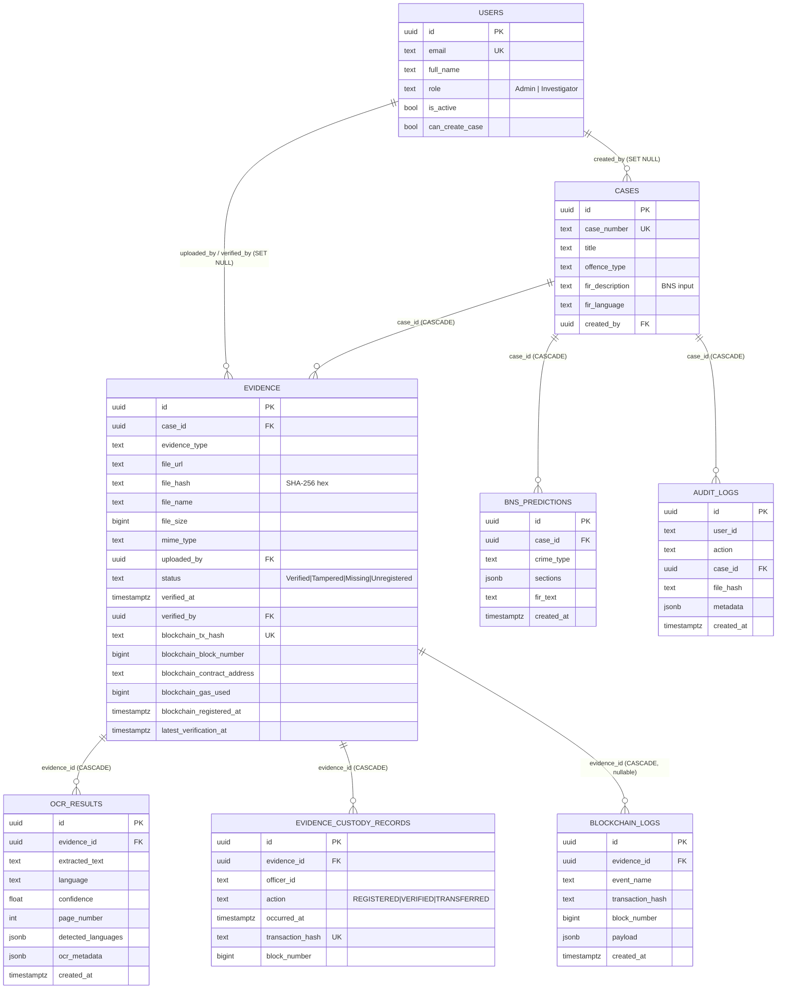
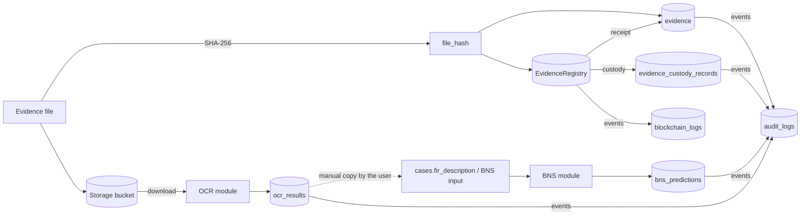

# Chapter 8 — Database Interaction

## 8.1 Persistence components

| Component | Role | Access path | Source |
|---|---|---|---|
| **PostgreSQL** (hosted by Supabase) | System of record for cases, evidence, OCR, BNS, custody, blockchain logs, audit logs | SQLAlchemy 2 engine from `DATABASE_URL`, or `DB_USER`/`DB_PASSWORD`/`DB_HOST`/`DB_PORT`/`DB_NAME`: pool 10 + overflow 20, `pool_pre_ping`, 30-min recycle, LIFO, 10 s connect timeout; one session per request (`get_db`) | `backend/db.py` |
| **Supabase REST client** (`supabase_admin`, service-role key) | Reads the Supabase `users` table during authentication (`is_active`, `can_create_case`); legacy fallbacks | `supabase-py` | `app.py` |
| **Supabase Storage**, bucket `evidence` | Evidence files at `cases/{case_id}/{uuid}_{filename}`; addressed by *public* URL | `supabase_admin.storage.from_("evidence")` | `app.py::upload_evidence` |
| **Local storage** (alternative) | `backend/uploads/cases/{case_id}/…`, served at `/uploads` by FastAPI `StaticFiles` | filesystem | `USE_LOCAL_STORAGE=true` |
| **Ethereum (Ganache)** | Evidence digests and custody (Chapter 7) | Web3.py | `blockchain_service.py` |

## 8.2 ER diagram (tables used by the three modules)

## 8.3 Access matrix (R = read, W = write, D = delete)

| Table / store | OCR module | BNS module | Blockchain module |
|---|---|---|---|
| `users` (Postgres + Supabase REST) | R (auth, via JWT user sync) | R (auth on store/read) | R (auth) |
| `cases` | R (access check; join in search) | R (access check); `fir_description` read by the frontend | R (access check) |
| `evidence` | R (`file_url`, `file_name`) | — | **W** (insert on upload; receipt columns; `status`, `verified_*`, `latest_verification_at`) |
| `ocr_results` | **R/W/D** (replace per evidence; translations in `ocr_metadata`) | — | — |
| `bns_predictions` | — | **R/W/D** (replace per case) | — |
| `evidence_custody_records` | — | — | **W** (REGISTERED / VERIFIED / TRANSFERRED), R |
| `blockchain_logs` | — | — | **W** (endpoints + listener), R (history, dashboard) |
| `audit_logs` | W ("OCR Extraction") | W ("BNS Classified") | W (Evidence Upload, Hash Verified, Tamper Detected, Evidence File Missing, Evidence Not Registered On-Chain, Database Hash Mismatch, Evidence Custody Transferred, EvidenceRegistry Redeployed, backfill actions) |
| Storage bucket | R (download for OCR) | — | W (upload), R (re-hash on verify) |
| Ethereum | — | — | W (register, verify, custody), R (getEvidence, history, logs) |

## 8.4 Transactional behaviour per module

| Module / operation | Transaction boundary | Concurrency control | Failure behaviour |
|---|---|---|---|
| Evidence upload (blockchain) | `INSERT evidence` is flushed, the chain transaction is mined, then receipt columns + custody + log are written and committed | Duplicate check on `(case_id, file_hash)`; UNIQUE `blockchain_tx_hash` | Chain failure → ROLLBACK, 503; the storage object remains |
| Verification | One commit for status + custody + log; audit separately | UNIQUE custody `transaction_hash` | Chain failure → 503 (no DB change); missing file or unregistered → status update + audit, then 404/409 |
| OCR storage | Single transaction: advisory lock, DELETE, INSERT pages | `pg_advisory_xact_lock(hashtext('ocr:'||id))` + per-evidence in-process lock | ROLLBACK → 500 |
| Translation storage | Update of `ocr_metadata` per page, one commit | none needed (idempotent, digest-bound) | ROLLBACK, logged; response unaffected |
| BNS store | DELETE case predictions + INSERT, one commit; audit after | none (last writer wins) | ROLLBACK → 500 |
| Audit log | Own commit (`write_audit_log`) | append-only by convention | Failure printed, never propagated |
| Event listener | One session per poll; commit all or roll back | de-dup on (tx hash, event name) | Exception → rollback, retried next poll |

## 8.5 Data flow across the modules

## 8.6 Schema management
- `schema.sql`: reference DDL for the core tables, including OCR and BNS.
- `migrate_blockchain.py`, `migrate_ocr_results.py`, `migrate_evidence_table.py`: idempotent `ADD COLUMN IF NOT EXISTS` and `CREATE TABLE IF NOT EXISTS` migrations, run by an operator.
- Startup hook `ensure_ocr_result_columns`: additive OCR columns only.
- The live database lacks the OCR unique index and the blockchain log constraints declared in the migrations (Sections 3.2 and 7.11). Migrations are applied manually; there is no migration framework (Alembic is listed in `requirements.txt` but unused).

## 8.7 Observations
1. Storage uses **public** bucket URLs (`get_public_url`). Integrity is protected by the chain, but **confidentiality is not**: anyone with the URL can download evidence.
2. The audit log is append-only **by convention** only. No database trigger, revoke or hash-chaining prevents an administrator from editing it. Anchoring periodic audit-log digests on-chain would close this.
3. Cascading deletes remove OCR, custody and blockchain log rows when evidence is deleted. On-chain records remain, which gives an independent trace of deleted evidence.
